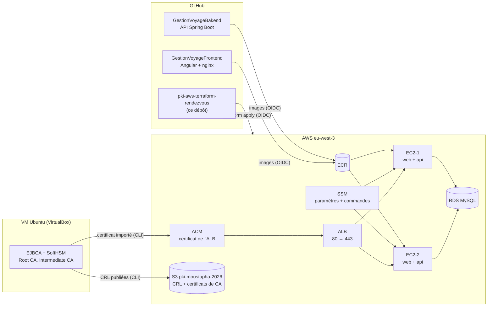

# Yoon sur AWS : Terraform, GitHub Actions et PKI EJBCA / SoftHSM

Projet pédagogique de Moustapha. L'application **Yoon** (réservation de voyages en car au Sénégal, billets QR,
contrôle à l'embarquement) est déployée sur AWS par Terraform et GitHub Actions. Elle est servie en **HTTPS avec
un certificat émis par notre propre PKI** (EJBCA, clés des autorités dans SoftHSM), sans nom de domaine acheté.

**État au 11/11/2026 : environnement `dev` en ligne, en HTTPS.**

| Élément | Valeur actuelle |
|---|---|
| URL | `https://alb-moustapha-dev-2014044716.eu-west-3.elb.amazonaws.com` |
| TLS | TLS 1.3, certificat RSA 3072 émis par `Lab-IntermediateCA-SoftHSM2`, valable jusqu'au 12/12/2027 |
| Port 80 | redirection permanente (301) vers HTTPS |
| Application | API Spring Boot + frontend Angular dans Docker sur 2 EC2, base RDS MySQL |
| Test final | scanner de billets par la caméra d'un téléphone Android : billet accepté, puis refusé au second scan |

> L'adresse dépend de l'ALB : elle **change si `dev` est détruit puis recréé**, et le certificat doit alors
> être réémis (voir [Exploitation](#exploitation)). Valeur actuelle : `terraform output load_balancer_url`.

## Sommaire

1. [Documentation](#documentation)
2. [Architecture](#architecture)
3. [Organisation du dépôt](#organisation-du-dépôt)
4. [Prérequis](#prérequis)
5. [Déployer](#déployer)
6. [HTTPS et PKI](#https-et-pki)
7. [Exploitation](#exploitation)
8. [Sécurité](#sécurité)
9. [Coûts](#coûts)
10. [Historique du projet](#historique-du-projet)
11. [Difficultés rencontrées et solutions](#difficultés-rencontrées-et-solutions)
12. [Feuille de route](#feuille-de-route)
13. [Références](#références)

---

## Documentation

| Document | Contenu |
|---|---|
| [`docs/DEPLOIEMENT-YOON.md`](docs/DEPLOIEMENT-YOON.md) | Déploiement de l'application : OIDC, ECR, images, serveurs Docker, SSM (étapes 0 à 3) |
| [`docs/PKI-HTTPS-YOON.md`](docs/PKI-HTTPS-YOON.md) | **Procédure** HTTPS avec EJBCA / SoftHSM : réglages, commandes, vérifications (étape 4) |
| [`docs/HTTPS-REALISATION-2026-11.md`](docs/HTTPS-REALISATION-2026-11.md) | **Compte rendu** de la mise en place du HTTPS (5 au 11/11/2026) : résultats, erreurs, corrections |
| [`docs/Yoon-rapport-deploiement-AWS-PKI-EJBCA.pdf`](docs/Yoon-rapport-deploiement-AWS-PKI-EJBCA.pdf) | Rapport complet illustré (captures d'écran), du début à la fin |
| `modules/*/README.md` | Documentation de chaque module Terraform |
| [`docs/HISTORIQUE-LABORATOIRE-2026-10.md`](docs/HISTORIQUE-LABORATOIRE-2026-10.md) | Ancien README : laboratoire initial du 26 au 28/10 (workspaces, tests HTTP, SSH, MySQL) |

## Architecture



| Élément | Configuration |
|---|---|
| Région | Paris, `eu-west-3` |
| VPC | `10.0.0.0/16` ; publics `10.0.1.0/24`, `10.0.2.0/24` ; privés `10.0.3.0/24`, `10.0.4.0/24` ; NAT unique |
| EC2 | 2 × Ubuntu 24.04 (`t3.micro` en dev), Docker, IMDSv2 obligatoire, disque gp3 chiffré |
| Conteneurs | `web` (nginx, port 80, relaie `/api`) et `api` (Spring Boot, port 8093 interne, profil `prod`) |
| RDS | MySQL 8.0, `db.t3.micro`, sous-réseaux privés, Single-AZ |
| ALB | listener 80 (redirection) et 443 (`ELBSecurityPolicy-TLS13-1-2-2021-06`), cibles HTTP 80 |
| Secrets applicatifs | SSM Parameter Store `/yoon/<env>/*` (SecureString) |
| PKI | EJBCA dans Docker sur une VM Ubuntu ; clés des CA dans SoftHSM (non exportables) |

## Organisation du dépôt

```
.
├── .github/workflows/terraform.yml   plan sur PR (dev, staging, prod) ; apply / destroy à la demande
├── .gitattributes                    *.sh et *.tftpl en fins de ligne LF
├── bootstrap/                        état LOCAL, appliqué depuis le poste
│   ├── main.tf                       bucket d'état terraform-bucket-moustapha-2026
│   ├── oidc.tf                       fournisseur OIDC GitHub, github-actions-role
│   ├── ecr.tf, deploy_role.tf        registres ECR, yoon-app-deploy-role
│   ├── pki_publication.tf            bucket pki-moustapha-2026 (CRL et certificats de CA)
│   └── outputs.tf, outputs_pki.tf
├── modules/
│   ├── vpc/  security/  rds/         réseau, groupes de sécurité, MySQL
│   ├── ec2/                          instances (profil IAM, IMDSv2, disque chiffré)
│   ├── alb/                          ALB, groupe cible, listeners 80 et 443 (certificate_arn)
│   └── app/                          SSM, rôle IAM des EC2, user data, deploy.sh
├── environments/
│   └── dev/  staging/  prod/         main.tf, variables.tf, outputs.tf, backend.tf, terraform.tfvars
└── docs/                             guides, compte rendu, rapport PDF
```

Règles d'architecture :

- chaque module a son `README.md` ;
- **les trois environnements ont le même code** : seules les valeurs de `terraform.tfvars` diffèrent ;
- une nouvelle variable de module a une valeur par défaut qui conserve le comportement existant (ex. `certificate_arn = null`) ;
- les changements arrivent par pull request ; la pipeline affiche le plan des trois environnements.

> `terraform.tfstate.d/` et `.terraform/` à la racine sont des **restes du premier laboratoire** (workspaces locaux,
> avant le passage aux dossiers `environments/`). Ils sont ignorés par Git. Vérifier qu'ils ne gèrent plus aucune
> ressource avant de les supprimer.

## Prérequis

| Outil | Usage |
|---|---|
| Terraform ≥ 1.10 | bootstrap en local ; `fmt` / `validate` avant chaque PR |
| AWS CLI v2 | vérifications, SSM, ACM, S3 |
| Git | branches, pull requests |
| OpenSSL | clés, CSR, vérifications de certificats |
| EJBCA + SoftHSM (Docker) | PKI, sur la VM Ubuntu |

Connexion AWS (poste Windows ou VM) :

```powershell
aws login --profile moustapha-login --region eu-west-3
aws sts get-caller-identity --profile moustapha-login     # Account : 231644789895
$env:AWS_PAGER = ""                                       # évite le blocage de l'affichage
```

Dans la VM, sans navigateur relié au terminal : `aws login --profile moustapha-login --region eu-west-3 --remote`,
ouvrir l'URL dans Firefox, puis coller le **code de vérification** (jamais le mot de passe) dans le terminal.

## Déployer

### 1. Bootstrap (une fois, en local)

Ressources durables, jamais détruites avec un environnement : bucket d'état, OIDC, rôles, ECR, bucket PKI.

```powershell
cd bootstrap
terraform init
terraform plan
terraform apply
terraform output
```

L'état du bootstrap est **local** : après chaque `apply`, en sauvegarder une copie hors du PC.

### 2. Environnements (par GitHub Actions)

```powershell
git fetch origin
git switch -c ma-branche origin/main
# modifications, puis vérifications :
terraform -chdir=environments/dev init -backend=false
terraform -chdir=environments/dev validate
git add <fichiers précis>
git commit -m "..."
git push -u origin ma-branche
```

1. Ouvrir la pull request : la pipeline lance `plan` pour dev, staging et prod.
2. Lire le plan de chaque environnement ; refuser tout remplacement inattendu (ALB, EC2, RDS).
3. Fusionner, puis **Actions → Terraform CI/CD → Run workflow** : `apply`, environnement choisi.

Secrets GitHub du dépôt : `AWS_ROLE_ARN` (rôle `github-actions-role`) et `DB_PASSWORD`
(passé à Terraform par `-var`, donc prioritaire sur `terraform.tfvars`).

### 3. Application

Chaque fusion sur `main` des dépôts `GestionVoyageBakend` et `GestionVoyageFrontend` publie une image dans ECR
(tags SHA et `latest`). Au premier démarrage, les EC2 lancent la dernière image. Redéploiement à distance :

```powershell
aws ssm send-command --region eu-west-3 --document-name AWS-RunShellScript `
  --instance-ids <id-ec2> --parameters 'commands=/opt/yoon/deploy.sh all latest'
```

Détails : [`docs/DEPLOIEMENT-YOON.md`](docs/DEPLOIEMENT-YOON.md).

### 4. Vérifier

```powershell
terraform -chdir=environments/dev output load_balancer_url
$tg = aws elbv2 describe-target-groups --region eu-west-3 --names tg-moustapha-dev --query "TargetGroups[0].TargetGroupArn" --output text
aws elbv2 describe-target-health --region eu-west-3 --target-group-arn $tg --query "TargetHealthDescriptions[].TargetHealth.State"
```

Attendu : l'URL en `https://`, et `["healthy", "healthy"]`.

## HTTPS et PKI

| Élément | Valeur |
|---|---|
| Root CA | `CN=Lab-RootCA-SoftHSM2,O=PKI LAB,C=FR`, jusqu'au 13/10/2036, SHA-1 `BD:C1:3C:57:0B:FD:A2:E4:37:6D:24:8E:35:20:23:E4:29:E4:6A:5A` |
| Intermediate CA | `CN=Lab-IntermediateCA-SoftHSM2,O=PKI LAB,C=FR`, jusqu'au 15/10/2031 |
| Profils EJBCA | `TLS-SERVER-YOON` (certificat) et `EE-TLS-YOON` (entité) |
| Entité | `alb-yoon-dev` |
| Certificat de l'ALB | RSA 3072, SAN = nom DNS de l'ALB, CDP et AIA vers S3, n° de série `5D0C16B5F3D37AC6DD332CE7047BDE1B79296AAC` |
| ACM | `arn:aws:acm:eu-west-3:231644789895:certificate/5c6f0b7d-92c0-4568-87f5-8c4fb01fa4ce` |
| Activation | `certificate_arn` dans `environments/dev/terraform.tfvars` |
| Publication | `http://pki-moustapha-2026.s3.eu-west-3.amazonaws.com/{ca,crl}/…` |

Principes :

- le certificat porte le **nom DNS de l'ALB** (pas de domaine) ; pas de certificat générique `*.elb.amazonaws.com` ;
- la clé de l'ALB est créée par OpenSSL dans la VM et importée dans ACM **par la CLI** : jamais dans Git ni dans l'état Terraform ;
- les clés des CA restent dans SoftHSM ;
- les CRL sont publiées en HTTP sur un bucket du bootstrap, à adresse fixe ;
- sur les appareils, seule la **Root** est installée (vérifier l'empreinte SHA-1 ci-dessus).

Procédure complète : [`docs/PKI-HTTPS-YOON.md`](docs/PKI-HTTPS-YOON.md). Ce qui a été fait :
[`docs/HTTPS-REALISATION-2026-11.md`](docs/HTTPS-REALISATION-2026-11.md).

## Exploitation

| Tâche | Fréquence | Comment |
|---|---|---|
| Publier la CRL de l'Intermediate | avant chaque *nextUpdate* (7 jours) | `ca createcrl` + `ca getcrl` dans le conteneur EJBCA, puis `aws s3 cp` |
| Publier la CRL de la Root | tous les 30 jours | idem avec `Lab-RootCA-SoftHSM2` |
| Renouveler le certificat de l'ALB | 30 jours avant le 12/12/2027 | réémission, puis réimport **sur le même ARN** (aucun changement Terraform) |
| `dev` recréé (nouveau nom d'ALB) | après chaque `destroy` / `apply` | nouvelle CSR, émission, import (nouvel ARN), `certificate_arn`, PR, apply |
| Sauvegarder l'état du bootstrap | après chaque apply du bootstrap | copie de `bootstrap/terraform.tfstate` hors du PC |
| Sauvegarder la PKI | régulièrement | instantané de la VM ; copie de SoftHSM et de la base EJBCA hors de la VM |

Publication hebdomadaire de la CRL (VM) :

```bash
export AWS_PROFILE=moustapha-login AWS_REGION=eu-west-3 AWS_PAGER=""
cd ~/pki-yoon/ca
docker exec ejbca-hsm-lab-ejbca-1 /opt/keyfactor/bin/ejbca.sh ca createcrl --caname "Lab-IntermediateCA-SoftHSM2"
docker exec ejbca-hsm-lab-ejbca-1 /opt/keyfactor/bin/ejbca.sh ca getcrl --caname "Lab-IntermediateCA-SoftHSM2" -f /tmp/intermediate-ca.crl
docker cp ejbca-hsm-lab-ejbca-1:/tmp/intermediate-ca.crl intermediate-ca.crl
openssl crl -inform DER -in intermediate-ca.crl -noout -crlnumber -nextupdate
aws s3 cp intermediate-ca.crl s3://pki-moustapha-2026/crl/intermediate-ca.crl --content-type application/pkix-crl
```

Pour limiter les coûts sans changer le nom de l'ALB, préférer l'arrêt des EC2 et de RDS à un `destroy`.

## Sécurité

| Élément | Où il vit | Jamais |
|---|---|---|
| Clés des CA | SoftHSM, dans la VM | exportées, copiées, dans Git |
| Clé de l'ALB (`alb.key`) | ACM (chiffrée) et `~/pki-yoon/alb` (droits 600) | dans Git, sur S3, dans Terraform |
| `SuperAdmin.p12`, PIN SoftHSM | `~/pki-lab-backups/admin` (700/600), coffre de mots de passe | dans un fichier du projet |
| `key/terraformcloud.pem` | dossier `key/`, ignoré par Git | commité |
| États Terraform | S3 privé (environnements), local + sauvegardes (bootstrap) | dans Git |
| Secrets de l'application | SSM SecureString | dans une image ou un fichier commité |
| Certificats de CA et CRL | bucket public | — publics par nature |

Contrôles avant chaque commit :

```powershell
git status --short
git diff | Select-String -Pattern 'BEGIN .*PRIVATE KEY|password\s*=\s*"|secret\s*=\s*"'
git ls-files key/ '*.tfstate' '*.tfstate.*'
```

Actions de sécurité en cours :

- [ ] retirer `db_password` de `environments/*/terraform.tfvars` (valeur en clair dans l'historique Git ; la pipeline utilise déjà le secret `DB_PASSWORD`), puis changer ce secret ;
- [ ] changer le mot de passe de la console AWS (exposé) et activer la MFA ;
- [ ] changer les mots de passe des comptes de démonstration avant tout usage réel ;
- [ ] réduire les droits larges de `github-actions-policy` ;
- [ ] révoquer l'ancien secret OAuth Google et l'ancien mot de passe MySQL présents dans l'historique du dépôt backend.

## Coûts

Une fois déployé, `dev` génère des frais : ALB, NAT Gateway, EC2, IPv4 publiques, RDS, transferts. Le label
Free Tier d'un type d'instance ne rend pas le projet gratuit. Les buckets S3 et ECR du bootstrap coûtent peu.

Arrêter les EC2 ne supprime pas les coûts de l'ALB et de la NAT. Un `destroy` supprime tout, y compris RDS et ses
données (pas de snapshot final), **et change le nom de l'ALB** : le certificat est alors à réémettre.

## Historique du projet

| Période | Étape | Résultat |
|---|---|---|
| 26–28/10 | Laboratoire initial : 5 modules, workspaces locaux, pages Nginx de test | 34 ressources déployées, testées (HTTP, SSH, MySQL), puis détruites |
| 31/10 | Passage aux dossiers `environments/` + état S3 + pipeline GitHub Actions | `plan` sur PR, `apply` / `destroy` à la demande |
| 01–02/11 | OIDC GitHub → AWS | correction du `sub` au format avec identifiants numériques |
| 03/11 | Étape 1 : ECR, `yoon-app-deploy-role` | `6 added, 1 changed` |
| 04/11 | Étape 2 : images dans ECR ; étape 3 : serveurs Docker (PR #13, #14) | application en ligne en HTTP, 351 départs de démonstration |
| 05/11 | Étape 4a : bucket des CRL (PR #15) | `5 added` |
| 05–07/11 | Étape 4b : réglages EJBCA, CRL, profils ; incident de la VM réparé | CRL publiées sur S3 |
| 10/11 | Étapes 4c–4e : certificat RSA 3072, ACM, listener 443 (PR #16) | HTTPS actif, TLS 1.3 |
| 10–11/11 | Étape 4f : Root sur Windows et Android ; test du scanner | caméra fonctionnelle, billet accepté puis refusé |

Les mesures du laboratoire initial (EC2 `i-06080da267470e3af`, ALB `alb-moustapha-dev-1633483388…`, test MySQL
avec `--ssl-mode=REQUIRED`, etc.) sont historiques : ces ressources n'existent plus.

## Difficultés rencontrées et solutions

| Problème | Cause | Solution |
|---|---|---|
| Région `us-east-3` invalide | mauvaise valeur | `eu-west-3` |
| `t2.micro` refusé | non éligible pour le compte | `t3.micro` après `describe-instance-types` |
| Paire SSH introuvable | créée à Stockholm | paire recréée à Paris |
| `UNPROTECTED PRIVATE KEY FILE` | droits Windows trop ouverts | `icacls` sur la clé |
| `AssumeRoleWithWebIdentity` refusé | `sub` OIDC avec identifiants numériques | afficher le `sub` réel, corriger la trust policy |
| ALB en 502 au premier apply | EC2 créées avant RDS et SSM | `depends_on = [module.app]`, attente SSM, relance par SSM |
| PR qui n'apparaît pas | branche déjà fusionnée | nouvelle branche depuis `origin/main` |
| `BlockPublicPolicy` | blocage public au niveau du compte | autoriser les politiques pour le bucket PKI |
| URL du certificat dans « Default CRL Issuer » | champ confondu | CRL Issuer vide, URL dans « CA issuer Default URI » |
| Écran noir puis kernel panic de la VM | Additions invité VirtualBox (`vboxguest(OE)`), disque incohérent | `fsck`, GRUB `module_blacklist=vboxguest`, désinstallation |
| `aws login` : code invalide | mot de passe saisi au lieu du code | `--remote`, coller le code de vérification |
| `LoadBalancerNotFound` | `dev` détruit, nouveau nom d'ALB | recréer, réémettre le certificat |
| `Illegal key length … 2048` | profil enregistré avec 3072 seulement | clé RSA 3072 ; profil corrigé |
| Certificat sans CDP | « Use CA defined CRL DP » non enregistré | profil corrigé (vérifié par `ca exportprofiles`), réémission |
| `No certificate found` à la révocation | « Use Certificate Storage » désactivé | stockage activé, réémission, réimport sur le même ARN |
| Android refuse la Root | Android 11+ | installation par les Paramètres (« Certificat AC ») |

## Feuille de route

- [x] Laboratoire initial : 5 modules, déploiement, tests HTTP / SSH / MySQL, destruction.
- [x] Environnements dev / staging / prod, état S3 verrouillé, pipeline GitHub Actions.
- [x] OIDC GitHub → AWS (aucune clé AWS dans GitHub).
- [x] Registres ECR et publication des images par la CI des dépôts d'application.
- [x] Serveurs Docker, secrets dans SSM, application Spring Boot / Angular en ligne avec RDS.
- [x] Intégration EJBCA / SoftHSM : CA, profils, CRL publiées sur S3.
- [x] HTTPS sur l'ALB avec un certificat de notre PKI, redirection HTTP → HTTPS.
- [x] Confiance de la Root sur Windows, Firefox et Android ; scanner caméra validé.
- [ ] Corriger le délai de paiement « dépassé » dès l'ouverture (dates sans fuseau horaire, à confirmer).
- [ ] Retirer `db_password` des `terraform.tfvars` et faire la rotation du mot de passe RDS.
- [ ] Script de réémission du certificat après recréation de `dev`.
- [ ] Automatiser la publication hebdomadaire des CRL ; confirmer le service EJBCA « CRL Updater ».
- [ ] Déploiement continu des applications (SSM, une EC2 après l'autre).
- [ ] Sauvegarde de SoftHSM et de la base EJBCA hors de la VM ; test de restauration.
- [ ] Retirer `continue-on-error` du job `apply` de la pipeline (un échec doit apparaître en rouge).
- [ ] mTLS pour les agents et vérification du rejet d'un certificat révoqué.
- [ ] Nom de domaine : remplacer le SAN de l'ALB, enregistrement DNS vers l'ALB.
- [ ] Déployer staging puis prod.

## Références

- [Terraform](https://developer.hashicorp.com/terraform/docs) · [Fournisseur AWS](https://registry.terraform.io/providers/hashicorp/aws/latest/docs)
- [Application Load Balancers](https://docs.aws.amazon.com/elasticloadbalancing/latest/application/application-load-balancers.html)
- [Importer un certificat dans ACM](https://docs.aws.amazon.com/acm/latest/userguide/import-certificate-prerequisites.html)
- [GitHub Actions OIDC avec AWS](https://docs.github.com/actions/security-for-github-actions/security-hardening-your-deployments/configuring-openid-connect-in-amazon-web-services)
- [EJBCA](https://docs.keyfactor.com/ejbca/latest/) · [SoftHSM](https://www.opendnssec.org/softhsm/)

## Licence

Aucune licence de réutilisation n'est attribuée pour le moment.
