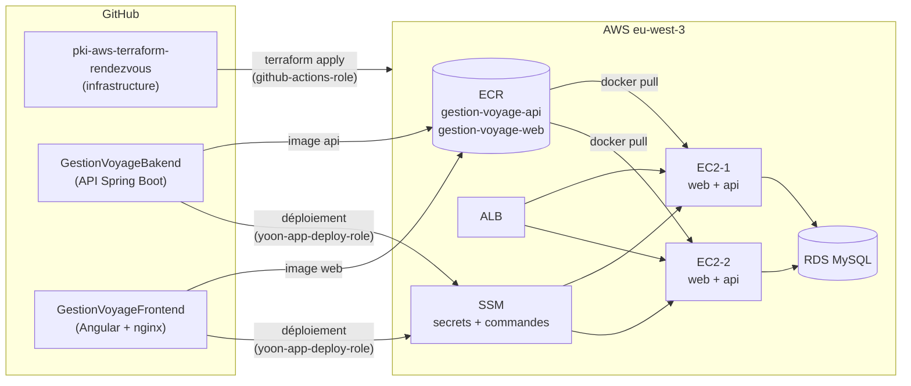

# Déploiement de l'application Yoon sur AWS

Ce document décrit comment l'application **Yoon** (réservation de voyages en car au Sénégal, billets à QR code)
est déployée sur l'infrastructure de ce dépôt avec Terraform et GitHub Actions.

Il complète le [README principal](../README.md), qui documente l'infrastructure de base
(VPC, sécurité, EC2, RDS, ALB) et le bootstrap (bucket S3 des states, OIDC).

| Étape | Contenu | État |
|---|---|---|
| [1. Registres d'images et rôle de déploiement](#étape-1--registres-dimages-et-rôle-de-déploiement) | ECR, rôle IAM des dépôts d'application, droits de la pipeline | ✅ Appliquée le 03/11/2026 |
| [2. Publication des images dans ECR](#étape-2--publication-des-images-dans-ecr) | Workflows des dépôts backend et frontend | ⏳ À venir |
| [3. Serveurs prêts pour Docker](#étape-3--serveurs-prêts-pour-docker) | Rôle des EC2, secrets SSM, user data Docker | ⏳ À venir |
| [4. Déploiement continu et HTTPS](#étape-4--déploiement-continu-et-https) | Mise à jour automatique des EC2, certificat sur l'ALB | ⏳ À venir |

## Sommaire

1. [Vue d'ensemble](#vue-densemble)
2. [Les trois dépôts](#les-trois-dépôts)
3. [Authentification GitHub vers AWS (OIDC)](#authentification-github-vers-aws-oidc)
4. [Étape 1 : registres d'images et rôle de déploiement](#étape-1--registres-dimages-et-rôle-de-déploiement)
5. [Étape 2 : publication des images dans ECR](#étape-2--publication-des-images-dans-ecr)
6. [Étape 3 : serveurs prêts pour Docker](#étape-3--serveurs-prêts-pour-docker)
7. [Étape 4 : déploiement continu et HTTPS](#étape-4--déploiement-continu-et-https)
8. [Secrets et paramètres](#secrets-et-paramètres)
9. [Dépannage](#dépannage)
10. [Retour arrière et suppression](#retour-arrière-et-suppression)

---

## Vue d'ensemble



Chaque EC2 fait tourner deux conteneurs :

| Conteneur | Image | Port | Rôle |
|---|---|---|---|
| `web` | `gestion-voyage-web` | 80 (exposé à l'ALB) | sert l'application Angular et relaie `/api` vers le conteneur `api` |
| `api` | `gestion-voyage-api` | 8093 (réseau Docker interne) | API Spring Boot, profil `prod`, base RDS MySQL |

Principe de séparation :

- **Terraform crée l'infrastructure** : réseau, serveurs, base, registres, rôles. Il est rarement relancé.
- **Les dépôts d'application livrent des versions** : ils construisent une image, la poussent dans ECR
  et demandent aux EC2 de la récupérer. Ils ne peuvent pas modifier l'infrastructure.

Modifier une page Angular ne déclenche donc jamais de `terraform apply`.

## Les trois dépôts

| Dépôt | Contenu | Rôle AWS utilisé | Branche |
|---|---|---|---|
| [`pki-aws-terraform-rendezvous`](https://github.com/kamoustaph/pki-aws-terraform-rendezvous) | Terraform : bootstrap, modules, environnements | `github-actions-role` | `main` |
| [`GestionVoyageBakend`](https://github.com/kamoustaph/GestionVoyageBakend) | API Spring Boot, Dockerfile, CI | `yoon-app-deploy-role` | `main` |
| [`GestionVoyageFrontend`](https://github.com/kamoustaph/GestionVoyageFrontend) | Application Angular, image nginx, CI | `yoon-app-deploy-role` | `main` |

## Authentification GitHub vers AWS (OIDC)

Aucune clé d'accès AWS n'est stockée dans GitHub. Chaque workflow demande à GitHub un jeton OIDC
de courte durée, qu'AWS échange contre des identifiants temporaires si le jeton correspond
à la **trust policy** du rôle.

Le fournisseur OIDC `token.actions.githubusercontent.com` est créé dans `bootstrap/oidc.tf`.

### Format du `sub` (point d'attention)

Ce compte GitHub envoie le claim `sub` au format **avec identifiants numériques** :

```
repo:kamoustaph@162557925/pki-aws-terraform-rendezvous@1433162106:pull_request
     └── propriétaire@id ──┘ └──────── dépôt@id ─────────────────┘ └ contexte ┘
```

et non au format classique `repo:kamoustaph/pki-aws-terraform-rendezvous:pull_request`.
Une trust policy écrite au format classique est refusée avec l'erreur
`Not authorized to perform sts:AssumeRoleWithWebIdentity` (voir [Dépannage](#dépannage)).

Conséquence importante : **renommer ou recréer un dépôt change son identifiant**
et casse l'accès à AWS. Les dépôts existants doivent être conservés.

### Rôles et contextes autorisés

| Rôle | Dépôt | Contextes `sub` acceptés | Condition |
|---|---|---|---|
| `github-actions-role` | `pki-aws-terraform-rendezvous@1433162106` | `pull_request`, `environment:dev`, `environment:staging`, `environment:prod`, `ref:refs/heads/main` | `StringEquals` |
| `yoon-app-deploy-role` | `GestionVoyageBakend`, `GestionVoyageFrontend` | `ref:refs/heads/main` uniquement | `StringLike` (voir ci-dessous) |

Pour `yoon-app-deploy-role`, deux formes sont acceptées par dépôt :

```
repo:kamoustaph@162557925/GestionVoyageBakend@*:ref:refs/heads/main
repo:kamoustaph/GestionVoyageBakend:ref:refs/heads/main
```

Le joker `*` remplace l'identifiant du dépôt. Le propriétaire reste vérifié par son identifiant (`162557925`).
Seule la branche `main` peut déployer : une pull request ou une autre branche est refusée.

---

## Étape 1 : registres d'images et rôle de déploiement

**État : appliquée le 03/11/2026, en local depuis `bootstrap/`.**
Résultat : `6 added, 1 changed, 0 destroyed`.

### Pourquoi dans le bootstrap ?

Les registres d'images et le rôle de déploiement sont **partagés par tous les environnements** :
la même image est testée en dev puis promue en staging et en prod.
Ils ne doivent pas disparaître lors d'un `terraform destroy` de dev.
Le bootstrap, appliqué séparément, est l'endroit prévu pour ces ressources durables.

### Fichiers

| Fichier | Statut | Contenu |
|---|---|---|
| `bootstrap/ecr.tf` | nouveau | 2 registres ECR et leur politique de rétention |
| `bootstrap/deploy_role.tf` | nouveau | rôle `yoon-app-deploy-role` et ses permissions |
| `bootstrap/oidc.tf` | modifié | ajout de `ssm:*` et `ecr:*` à `github-actions-policy` |
| `bootstrap/outputs.tf` | modifié | sorties `ecr_repository_urls` et `app_deploy_role_arn` |

### Ressources créées

| Ressource Terraform | Nom AWS | Détail |
|---|---|---|
| `aws_ecr_repository.app["api"]` | `gestion-voyage-api` | analyse de vulnérabilités à chaque push, chiffrement AES256 |
| `aws_ecr_repository.app["web"]` | `gestion-voyage-web` | idem |
| `aws_ecr_lifecycle_policy.app["api"]` | | conserve les 15 images les plus récentes |
| `aws_ecr_lifecycle_policy.app["web"]` | | idem |
| `aws_iam_role.app_deploy` | `yoon-app-deploy-role` | trust policy OIDC des 2 dépôts d'application |
| `aws_iam_role_policy.app_deploy` | `yoon-app-deploy-policy` | permissions détaillées ci-dessous |
| `aws_iam_role_policy.github_actions` (modifiée) | `github-actions-policy` | `+ ssm:*`, `+ ecr:*` |

Les tags d'images sont modifiables (`MUTABLE`) pour que `latest` suive la dernière version.
Chaque image porte aussi le SHA de son commit, qui permet de revenir à une version précise.

### Permissions de `yoon-app-deploy-role`

Le rôle ne peut ni créer, ni modifier, ni détruire d'infrastructure.

| Bloc (`Sid`) | Actions | Portée |
|---|---|---|
| `EcrLogin` | `ecr:GetAuthorizationToken` | `*` (exigé par AWS) |
| `EcrPushPull` | lecture et écriture d'images | les 2 registres uniquement |
| `TrouverLesInstances` | `ec2:DescribeInstances` | lecture seule |
| `DocumentDeDeploiement` | `ssm:SendCommand` | document `AWS-RunShellScript` |
| `InstancesDuProjet` | `ssm:SendCommand` | instances portant le tag `Project=moustapha` |
| `SuivreLeDeploiement` | `ssm:GetCommandInvocation`, `ssm:ListCommandInvocations`, `ssm:DescribeInstanceInformation` | lecture seule |

### Pourquoi `ssm:*` et `ecr:*` sur la pipeline Terraform ?

À l'étape 3, `terraform apply` (lancé par `github-actions-role`) créera des paramètres SSM
pour les secrets de l'application et un rôle IAM pour les EC2. Sans `ssm:*`, l'apply échouerait.
Ces droits restent larges, comme le reste de `github-actions-policy` ; leur réduction est prévue séparément.

### Sorties

```text
app_deploy_role_arn = "arn:aws:iam::231644789895:role/yoon-app-deploy-role"
ecr_repository_urls = {
  "api" = "231644789895.dkr.ecr.eu-west-3.amazonaws.com/gestion-voyage-api"
  "web" = "231644789895.dkr.ecr.eu-west-3.amazonaws.com/gestion-voyage-web"
}
```

### Commandes utilisées

Le bootstrap a un state **local** : il s'applique depuis le poste, pas depuis la pipeline.

```powershell
cd bootstrap
terraform init
terraform plan     # attendu : 6 to add, 1 to change, 0 to destroy
terraform apply
terraform output
```

### Vérification

```powershell
aws ecr describe-repositories --region eu-west-3 --query "repositories[].repositoryUri"
aws iam get-role --role-name yoon-app-deploy-role --query "Role.Arn"
aws iam get-role-policy --role-name yoon-app-deploy-role --policy-name yoon-app-deploy-policy
```

### Configuration GitHub associée

Dans **GestionVoyageBakend** et **GestionVoyageFrontend** :
Settings → Secrets and variables → Actions → New repository secret.

| Secret | Valeur |
|---|---|
| `AWS_DEPLOY_ROLE_ARN` | `arn:aws:iam::231644789895:role/yoon-app-deploy-role` |

---

## Étape 2 : publication des images dans ECR

**État : à venir.**

Objectif : à chaque push sur `main`, les workflows des dépôts d'application poussent leur image
dans ECR (au lieu de GitHub Container Registry), avec deux tags : le SHA du commit et `latest`.
Cette étape précède la création des serveurs, pour que les EC2 trouvent les images dès leur premier démarrage.

*Section complétée lors de la réalisation de l'étape.*

## Étape 3 : serveurs prêts pour Docker

**État : à venir.**

Prévu :

- module `ec2` : profil d'instance IAM (lecture ECR, lecture des paramètres SSM, agent SSM) ;
- paramètres SSM `SecureString` pour le mot de passe de la base et les clés `JWT_SECRET` et `QR_SECRET` ;
- user data : installation de Docker, puis lancement des conteneurs `web` et `api` ;
- application d'abord en **dev** via la pipeline, puis staging et prod.

*Section complétée lors de la réalisation de l'étape.*

## Étape 4 : déploiement continu et HTTPS

**État : à venir.**

Prévu :

- après publication de l'image, mise à jour des EC2 **une par une** via SSM, pour éviter une interruption ;
- certificat ACM et écouteur 443 sur l'ALB. HTTPS est obligatoire pour la caméra du scanner de billets.

*Section complétée lors de la réalisation de l'étape.*

---

## Secrets et paramètres

Aucun secret n'est écrit dans le code ni dans les fichiers `.tfvars` versionnés.

| Nom | Où | Utilisé par | Étape |
|---|---|---|---|
| `AWS_ROLE_ARN` | secret du dépôt Terraform | pipeline Terraform (`github-actions-role`) | existant |
| `DB_PASSWORD` | secret du dépôt Terraform | `terraform plan/apply` (mot de passe RDS) | existant |
| `AWS_DEPLOY_ROLE_ARN` | secret des dépôts backend et frontend | workflows d'image et de déploiement | 1 |
| `/yoon/<env>/…` | AWS SSM Parameter Store | conteneur `api` au démarrage | 3 (à venir) |

Fichiers qui ne doivent jamais être publiés (déjà couverts par `.gitignore`) :
`*.tfstate`, `*.tfstate.*`, `.terraform/`, `*.pem`, `*.key`, `.env`.
Le state du bootstrap (`bootstrap/terraform.tfstate`) est local : en conserver une sauvegarde sécurisée.

---

## Dépannage

### `Not authorized to perform sts:AssumeRoleWithWebIdentity`

L'étape *Configure AWS credentials* répète « Assuming role with OIDC » puis échoue.

**Cause la plus fréquente** : le `sub` envoyé par GitHub ne correspond pas à la trust policy.
Pour l'afficher, ajouter temporairement ce step avant *Configure AWS credentials*
(le job doit avoir `permissions: id-token: write`) :

```yaml
- name: Afficher le sub OIDC
  uses: actions/github-script@v7
  with:
    script: |
      const t = await core.getIDToken('sts.amazonaws.com');
      const c = JSON.parse(Buffer.from(t.split('.')[1], 'base64url').toString());
      core.info(`sub: ${c.sub}`);
      core.info(`aud: ${c.aud}`);
```

Puis comparer la valeur avec `bootstrap/oidc.tf` ou `bootstrap/deploy_role.tf`.

Autres causes :

| Symptôme | Vérification |
|---|---|
| Le secret est vide | `AWS_ROLE_ARN` ou `AWS_DEPLOY_ROLE_ARN` défini au niveau du **dépôt**, pas seulement d'un environnement |
| Déploiement refusé depuis une PR | normal : `yoon-app-deploy-role` n'accepte que `main` |
| Dépôt renommé ou recréé | son identifiant numérique a changé : mettre à jour la trust policy |

### `AccessDenied` lors d'un push vers ECR

- Le workflow doit utiliser `AWS_DEPLOY_ROLE_ARN`, pas `AWS_ROLE_ARN`.
- Le nom du registre doit être exactement `gestion-voyage-api` ou `gestion-voyage-web`.

### `terraform plan` du bootstrap propose une destruction

Ne pas appliquer. Vérifier que les fichiers `bootstrap/*.tf` sont à jour (`git pull`)
et que le state local `bootstrap/terraform.tfstate` est bien présent.

---

## Retour arrière et suppression

**Revenir à une version précédente d'une application** (après l'étape 4) : redéployer l'image
correspondant à un SHA antérieur. Les 15 dernières images sont conservées dans ECR.

**Supprimer les ressources de l'étape 1** : retirer `bootstrap/ecr.tf` et `bootstrap/deploy_role.tf`,
puis `terraform apply` dans `bootstrap/`. AWS refuse de supprimer un registre ECR qui contient encore des images :
les supprimer d'abord dans la console (ECR → registre → sélectionner les images → Supprimer),
ou ajouter temporairement `force_delete = true` dans `aws_ecr_repository.app` et appliquer avant de retirer le fichier.

**Coût** : ECR facture le stockage des images (quelques centimes par mois pour 15 images de chaque application).
Le rôle IAM et les politiques sont gratuits.
