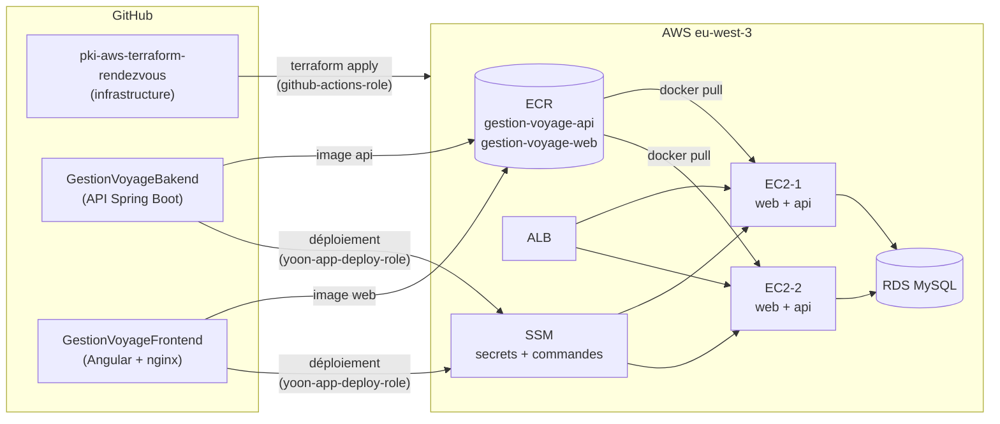
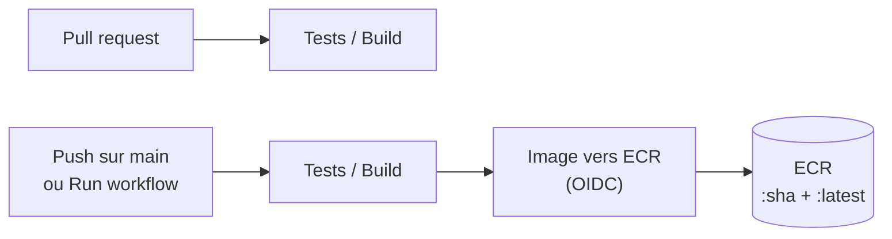
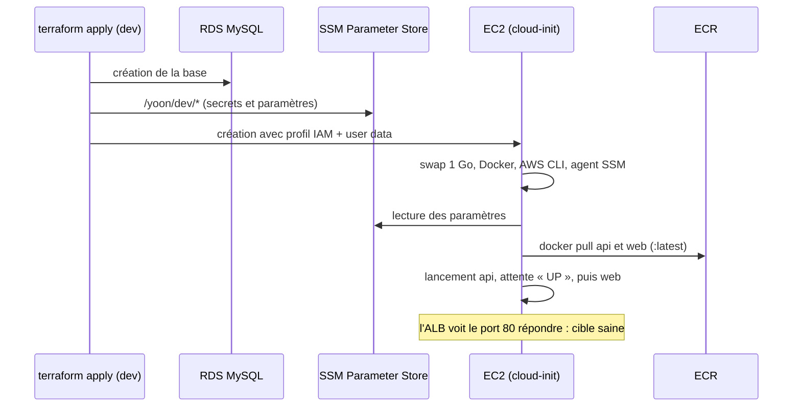

# Déploiement de l'application Yoon sur AWS

Ce document décrit comment l'application **Yoon** (réservation de voyages en car au Sénégal, billets à QR code)
est déployée sur l'infrastructure de ce dépôt avec Terraform et GitHub Actions.

Il complète le [README principal](../README.md), qui documente l'infrastructure de base
(VPC, sécurité, EC2, RDS, ALB) et le bootstrap (bucket S3 des states, OIDC).

| Étape | Contenu | État |
|---|---|---|
| [1. Registres d'images et rôle de déploiement](#étape-1--registres-dimages-et-rôle-de-déploiement) | ECR, rôle IAM des dépôts d'application, droits de la pipeline | ✅ Appliquée le 03/11/2026 |
| [2. Publication des images dans ECR](#étape-2--publication-des-images-dans-ecr) | Workflows des dépôts backend et frontend | ✅ Réalisée le 04/11/2026 |
| [3. Serveurs prêts pour Docker](#étape-3--serveurs-prêts-pour-docker) | Rôle des EC2, secrets SSM, user data Docker | 🔄 Prête à appliquer en dev |
| [4. Déploiement continu et HTTPS](#étape-4--déploiement-continu-et-https) | Mise à jour automatique des EC2, certificat sur l'ALB | ⏳ À venir |

## Sommaire

1. [Vue d'ensemble](#vue-densemble)
2. [Les trois dépôts](#les-trois-dépôts)
3. [Authentification GitHub vers AWS (OIDC)](#authentification-github-vers-aws-oidc)
4. [Étape 1 : registres d'images et rôle de déploiement](#étape-1--registres-dimages-et-rôle-de-déploiement)
5. [Étape 2 : publication des images dans ECR](#étape-2--publication-des-images-dans-ecr)
6. [Étape 3 : serveurs prêts pour Docker](#étape-3--serveurs-prêts-pour-docker)
7. [Étape 4 : déploiement continu et HTTPS](#étape-4--déploiement-continu-et-https)
8. [Secrets et paramètres](#secrets-et-paramètres)
9. [Dépannage](#dépannage)
10. [Retour arrière et suppression](#retour-arrière-et-suppression)

---

## Vue d'ensemble



Chaque EC2 fait tourner deux conteneurs :

| Conteneur | Image | Port | Rôle |
|---|---|---|---|
| `web` | `gestion-voyage-web` | 80 (exposé à l'ALB) | sert l'application Angular et relaie `/api` vers le conteneur `api` |
| `api` | `gestion-voyage-api` | 8093 (réseau Docker interne) | API Spring Boot, profil `prod`, base RDS MySQL |

Principe de séparation :

- **Terraform crée l'infrastructure** : réseau, serveurs, base, registres, rôles. Il est rarement relancé.
- **Les dépôts d'application livrent des versions** : ils construisent une image, la poussent dans ECR
  et demandent aux EC2 de la récupérer. Ils ne peuvent pas modifier l'infrastructure.

Modifier une page Angular ne déclenche donc jamais de `terraform apply`.

## Les trois dépôts

| Dépôt | Contenu | Rôle AWS utilisé | Branche |
|---|---|---|---|
| [`pki-aws-terraform-rendezvous`](https://github.com/kamoustaph/pki-aws-terraform-rendezvous) | Terraform : bootstrap, modules, environnements | `github-actions-role` | `main` |
| [`GestionVoyageBakend`](https://github.com/kamoustaph/GestionVoyageBakend) | API Spring Boot, Dockerfile, CI | `yoon-app-deploy-role` | `main` |
| [`GestionVoyageFrontend`](https://github.com/kamoustaph/GestionVoyageFrontend) | Application Angular, image nginx, CI | `yoon-app-deploy-role` | `main` |

## Authentification GitHub vers AWS (OIDC)

Aucune clé d'accès AWS n'est stockée dans GitHub. Chaque workflow demande à GitHub un jeton OIDC
de courte durée, qu'AWS échange contre des identifiants temporaires si le jeton correspond
à la **trust policy** du rôle.

Le fournisseur OIDC `token.actions.githubusercontent.com` est créé dans `bootstrap/oidc.tf`.

### Format du `sub` (point d'attention)

Ce compte GitHub envoie le claim `sub` au format **avec identifiants numériques** :

```
repo:kamoustaph@162557925/pki-aws-terraform-rendezvous@1433162106:pull_request
     └── propriétaire@id ──┘ └──────── dépôt@id ─────────────────┘ └ contexte ┘
```

et non au format classique `repo:kamoustaph/pki-aws-terraform-rendezvous:pull_request`.
Une trust policy écrite au format classique est refusée avec l'erreur
`Not authorized to perform sts:AssumeRoleWithWebIdentity` (voir [Dépannage](#dépannage)).

Conséquence importante : **renommer ou recréer un dépôt change son identifiant**
et casse l'accès à AWS. Les dépôts existants doivent être conservés.

### Rôles et contextes autorisés

| Rôle | Dépôt | Contextes `sub` acceptés | Condition |
|---|---|---|---|
| `github-actions-role` | `pki-aws-terraform-rendezvous@1433162106` | `pull_request`, `environment:dev`, `environment:staging`, `environment:prod`, `ref:refs/heads/main` | `StringEquals` |
| `yoon-app-deploy-role` | `GestionVoyageBakend`, `GestionVoyageFrontend` | `ref:refs/heads/main` uniquement | `StringLike` (voir ci-dessous) |

Pour `yoon-app-deploy-role`, deux formes sont acceptées par dépôt :

```
repo:kamoustaph@162557925/GestionVoyageBakend@*:ref:refs/heads/main
repo:kamoustaph/GestionVoyageBakend:ref:refs/heads/main
```

Le joker `*` remplace l'identifiant du dépôt. Le propriétaire reste vérifié par son identifiant (`162557925`).
Seule la branche `main` peut déployer : une pull request ou une autre branche est refusée.

---

## Étape 1 : registres d'images et rôle de déploiement

**État : appliquée le 03/11/2026, en local depuis `bootstrap/`.**
Résultat : `6 added, 1 changed, 0 destroyed`.

### Pourquoi dans le bootstrap ?

Les registres d'images et le rôle de déploiement sont **partagés par tous les environnements** :
la même image est testée en dev puis promue en staging et en prod.
Ils ne doivent pas disparaître lors d'un `terraform destroy` de dev.
Le bootstrap, appliqué séparément, est l'endroit prévu pour ces ressources durables.

### Fichiers

| Fichier | Statut | Contenu |
|---|---|---|
| `bootstrap/ecr.tf` | nouveau | 2 registres ECR et leur politique de rétention |
| `bootstrap/deploy_role.tf` | nouveau | rôle `yoon-app-deploy-role` et ses permissions |
| `bootstrap/oidc.tf` | modifié | ajout de `ssm:*` et `ecr:*` à `github-actions-policy` |
| `bootstrap/outputs.tf` | modifié | sorties `ecr_repository_urls` et `app_deploy_role_arn` |

### Ressources créées

| Ressource Terraform | Nom AWS | Détail |
|---|---|---|
| `aws_ecr_repository.app["api"]` | `gestion-voyage-api` | analyse de vulnérabilités à chaque push, chiffrement AES256 |
| `aws_ecr_repository.app["web"]` | `gestion-voyage-web` | idem |
| `aws_ecr_lifecycle_policy.app["api"]` | | conserve les 15 images les plus récentes |
| `aws_ecr_lifecycle_policy.app["web"]` | | idem |
| `aws_iam_role.app_deploy` | `yoon-app-deploy-role` | trust policy OIDC des 2 dépôts d'application |
| `aws_iam_role_policy.app_deploy` | `yoon-app-deploy-policy` | permissions détaillées ci-dessous |
| `aws_iam_role_policy.github_actions` (modifiée) | `github-actions-policy` | `+ ssm:*`, `+ ecr:*` |

Les tags d'images sont modifiables (`MUTABLE`) pour que `latest` suive la dernière version.
Chaque image porte aussi le SHA de son commit, qui permet de revenir à une version précise.

### Permissions de `yoon-app-deploy-role`

Le rôle ne peut ni créer, ni modifier, ni détruire d'infrastructure.

| Bloc (`Sid`) | Actions | Portée |
|---|---|---|
| `EcrLogin` | `ecr:GetAuthorizationToken` | `*` (exigé par AWS) |
| `EcrPushPull` | lecture et écriture d'images | les 2 registres uniquement |
| `TrouverLesInstances` | `ec2:DescribeInstances` | lecture seule |
| `DocumentDeDeploiement` | `ssm:SendCommand` | document `AWS-RunShellScript` |
| `InstancesDuProjet` | `ssm:SendCommand` | instances portant le tag `Project=moustapha` |
| `SuivreLeDeploiement` | `ssm:GetCommandInvocation`, `ssm:ListCommandInvocations`, `ssm:DescribeInstanceInformation` | lecture seule |

### Pourquoi `ssm:*` et `ecr:*` sur la pipeline Terraform ?

À l'étape 3, `terraform apply` (lancé par `github-actions-role`) créera des paramètres SSM
pour les secrets de l'application et un rôle IAM pour les EC2. Sans `ssm:*`, l'apply échouerait.
Ces droits restent larges, comme le reste de `github-actions-policy` ; leur réduction est prévue séparément.

### Sorties

```text
app_deploy_role_arn = "arn:aws:iam::231644789895:role/yoon-app-deploy-role"
ecr_repository_urls = {
  "api" = "231644789895.dkr.ecr.eu-west-3.amazonaws.com/gestion-voyage-api"
  "web" = "231644789895.dkr.ecr.eu-west-3.amazonaws.com/gestion-voyage-web"
}
```

### Commandes utilisées

Le bootstrap a un state **local** : il s'applique depuis le poste, pas depuis la pipeline.

```powershell
cd bootstrap
terraform init
terraform plan     # attendu : 6 to add, 1 to change, 0 to destroy
terraform apply
terraform output
```

### Vérification

```powershell
aws ecr describe-repositories --region eu-west-3 --query "repositories[].repositoryUri"
aws iam get-role --role-name yoon-app-deploy-role --query "Role.Arn"
aws iam get-role-policy --role-name yoon-app-deploy-role --policy-name yoon-app-deploy-policy
```

### Configuration GitHub associée

Dans **GestionVoyageBakend** et **GestionVoyageFrontend** :
Settings → Secrets and variables → Actions → New repository secret.

| Secret | Valeur |
|---|---|
| `AWS_DEPLOY_ROLE_ARN` | `arn:aws:iam::231644789895:role/yoon-app-deploy-role` |

---

## Étape 2 : publication des images dans ECR

**État : réalisée le 04/11/2026** (PR #2 de chaque dépôt d'application).

À chaque push sur `main`, le workflow `.github/workflows/ci.yml` de chaque dépôt d'application :

1. lance les tests (backend) ou le build de production (frontend) ;
2. s'authentifie auprès d'AWS par OIDC avec `yoon-app-deploy-role` ;
3. construit l'image Docker et la pousse dans ECR avec deux tags : le SHA du commit et `latest`.



| Événement | Tests / Build | Image vers ECR |
|---|---|---|
| Pull request | ✅ exécuté | ⏭️ ignoré (le rôle AWS n'accepte que `main`) |
| Push sur `main` | ✅ exécuté | ✅ exécuté |
| Run workflow (manuel, sur `main`) | ✅ exécuté | ✅ exécuté |

### Fichiers modifiés

| Dépôt | Fichier | Changement |
|---|---|---|
| GestionVoyageBakend | `.github/workflows/ci.yml` | publication vers ECR `gestion-voyage-api` (au lieu de GitHub Container Registry) |
| GestionVoyageFrontend | `.github/workflows/ci.yml` | publication vers ECR `gestion-voyage-web` |
| GestionVoyageFrontend | `nginx/default.conf.template` | transmet au backend le protocole d'origine (`X-Forwarded-Proto`) reçu de l'ALB, nécessaire au passage en HTTPS |

### Résultat

```text
gestion-voyage-api : latest, 4adbdfa878ec26c431f63b09d8984f366e31d10e
gestion-voyage-web : latest, fe2215a… (SHA complet du commit de fusion de la PR #2)
```

### Vérification

```powershell
aws ecr describe-images --region eu-west-3 --repository-name gestion-voyage-api --query "imageDetails[].imageTags"
aws ecr describe-images --region eu-west-3 --repository-name gestion-voyage-web --query "imageDetails[].imageTags"
```

### Points d'attention rencontrés

- Le job **Image vers ECR** est *skipped* sur une pull request : c'est voulu. L'image n'est publiée qu'après la fusion.
- Le secret `AWS_DEPLOY_ROLE_ARN` doit exister **avant** la fusion. S'il manquait, relancer le job depuis
  Actions → le run → *Re-run failed jobs*, ou Actions → *Run workflow* sur `main`.
- Relancer le run d'une pull request ne publie pas d'image : il faut un run sur `main`.

## Étape 3 : serveurs prêts pour Docker

**État : prête à appliquer en dev** (code identique dans les trois environnements).

Les instances EC2 n'installent plus nginx en dur : au premier démarrage, elles installent Docker,
lisent leurs secrets dans SSM, tirent les images depuis ECR et lancent les conteneurs `api` et `web`.



### Fichiers

| Fichier | Statut | Contenu |
|---|---|---|
| `modules/app/versions.tf` | nouveau | providers `aws` et `random` |
| `modules/app/variables.tf` | nouveau | entrées du module (base, images, données de démo, mémoire JVM) |
| `modules/app/main.tf` | nouveau | paramètres SSM, rôle et profil IAM des EC2, rendu du user data |
| `modules/app/outputs.tf` | nouveau | profil IAM, user data, préfixe SSM, registre ECR |
| `modules/app/user_data.sh.tftpl` | nouveau | script de premier démarrage |
| `modules/app/deploy.sh` | nouveau | script de (re)déploiement copié sur chaque instance |
| `modules/ec2/main.tf` | modifié | `iam_instance_profile`, `user_data_replace_on_change`, IMDSv2 obligatoire, disque gp3 chiffré |
| `modules/ec2/variables.tf` | modifié | `iam_instance_profile`, `root_volume_size` (16 Go), `instance_name` ; tous optionnels |
| `modules/app/README.md` | nouveau | documentation du module (entrées, sorties, paramètres, rôle) |
| `modules/ec2/README.md` | complété | section « Options ajoutées pour l'application Yoon » |
| `environments/{dev,staging,prod}/main.tf` | modifié | appel du module `app` ; les deux EC2 utilisent son user data et son profil |
| `environments/{dev,staging,prod}/variables.tf` | modifié | `demo_data` : `true` en dev, `false` en staging et prod |
| `environments/{dev,staging,prod}/outputs.tf` | modifié | sortie `app_ssm_prefix` |

Les trois environnements gardent un code identique ; seule la valeur par défaut de `demo_data` diffère.
Seul **dev** est appliqué à cette étape. Staging et prod le seront plus tard, avec leur propre `terraform.tfvars`
(qui doit définir `env = "staging"` ou `env = "prod"` : les paramètres SSM et les rôles IAM sont nommés d'après `env`).

### Paramètres SSM créés

| Paramètre | Type | Origine |
|---|---|---|
| `/yoon/dev/db_password` | SecureString | variable `db_password` (secret GitHub `DB_PASSWORD`) |
| `/yoon/dev/jwt_secret` | SecureString | généré par Terraform (64 caractères) |
| `/yoon/dev/qr_secret` | SecureString | généré par Terraform (48 caractères). **Le changer invalide tous les billets émis.** |
| `/yoon/dev/db_url` | String | `jdbc:mysql://<adresse RDS>:3306/moustaphadb?sslMode=PREFERRED` |
| `/yoon/dev/db_username` | String | variable `db_username` |
| `/yoon/dev/demo_data` | String | variable `demo_data` |
| `/yoon/dev/cors_allowed_origins` | String | `none` : inutile, le site et l'API partagent le domaine de l'ALB |
| `/yoon/dev/java_max_heap` | String | `384m`, adapté à une t3.micro |

Les valeurs sont aussi présentes dans le state Terraform (bucket S3 chiffré, accès privé).

### Rôle IAM des instances (`yoon-dev-ec2-role`)

| Permission | Pourquoi |
|---|---|
| `AmazonSSMManagedInstanceCore` | recevoir les commandes de déploiement ; se connecter par Session Manager sans SSH |
| `AmazonEC2ContainerRegistryReadOnly` | `docker pull` depuis ECR |
| `ssm:GetParameter*` sur `/yoon/dev/*` | lire **uniquement** les paramètres de son environnement |
| `kms:Decrypt` via SSM | déchiffrer les SecureString |

### Sur chaque instance

| Élément | Emplacement |
|---|---|
| Journal du premier démarrage | `/var/log/yoon-init.log` |
| Identité de l'instance (env, région, registre, rôle) | `/opt/yoon/instance.env` |
| Script de déploiement | `/opt/yoon/deploy.sh` |
| Variables de l'API (générées, droits 600) | `/opt/yoon/api.env` |
| Tags actuellement déployés | `/opt/yoon/api.tag`, `/opt/yoon/web.tag` |

| Conteneur | Image | Réseau | Mémoire max |
|---|---|---|---|
| `api` | `gestion-voyage-api:<tag>` | réseau Docker `yoon`, port 8093 non exposé | 640 Mo (JVM `-Xmx384m`) |
| `web` | `gestion-voyage-web:<tag>` | port 80 de l'instance (cible de l'ALB) | 128 Mo |

Utilisation de `deploy.sh` :

```bash
sudo /opt/yoon/deploy.sh                 # api + web, tag latest
sudo /opt/yoon/deploy.sh all  <sha>      # api + web à une version précise
sudo /opt/yoon/deploy.sh api  <sha>      # API seule (nginx redémarré ensuite)
sudo /opt/yoon/deploy.sh web  <sha>      # frontend seul
```

Les secrets sont relus dans SSM à chaque exécution : modifier un paramètre puis relancer `deploy.sh` suffit.

### Données de démonstration

EC2-1 reçoit le user data « primary » : il peut créer les comptes et départs de démonstration si la base est vide.
EC2-2 reçoit « secondary » : jamais. Cela évite deux insertions simultanées dans la même base.

| Rôle | Email | Mot de passe |
|---|---|---|
| Administrateur | admin@yoon.sn | Admin123! |
| Agent de contrôle | agent@yoon.sn | Agent123! |
| Voyageur | voyageur@yoon.sn | Voyageur123! |

En staging et prod, `demo_data` doit valoir `false`.

### Application

Par la pipeline, comme les autres changements d'infrastructure :

1. Pull request : le `plan dev` doit montrer la création des ressources du module `app`
   et des instances avec leur nouveau user data, sans erreur.
2. Fusion, puis Actions → Terraform CI/CD → *Run workflow* : `apply`, environnement `dev`.

Durée indicative : 10 à 15 minutes (RDS est le plus long), puis 3 à 5 minutes de démarrage des instances.

### Premier apply (04/11/2026) et correctif

Premier `apply dev` : `49 added, 0 changed, 0 destroyed`.
Adresse : `http://alb-moustapha-dev-755009444.eu-west-3.elb.amazonaws.com`.

**Problème constaté** : les EC2 ont été créées avant la fin de RDS (5 min 38 s),
donc avant les paramètres SSM qui en dépendent. Au premier démarrage, `deploy.sh` n'a pas trouvé
`/yoon/dev/db_url` et les conteneurs n'ont pas été lancés.

**Rattrapage** : relancer `deploy.sh` par SSM Run Command, instance primary d'abord
(voir [Relancer le déploiement à distance](#relancer-le-déploiement-à-distance)).

**Correctif** (même PR) :

- `environments/*/main.tf` : `depends_on = [module.app]` sur les deux EC2, qui ne sont créées
  qu'une fois tous les paramètres présents ;
- `modules/app/user_data.sh.tftpl` : attente des paramètres SSM (jusqu'à 20 minutes) avant le premier lancement.

Le user data ayant changé, le prochain `apply` **recrée les deux instances** (`user_data_replace_on_change`).

### Relancer le déploiement à distance

Depuis un poste disposant des droits SSM (ici avec PowerShell) :

```powershell
# 1. EC2-1 (primary) : crée le schéma de la base et les données de démonstration
$cmd = aws ssm send-command --region eu-west-3 --document-name AWS-RunShellScript `
  --instance-ids <id-ec2-1> --parameters 'commands=/opt/yoon/deploy.sh all latest' `
  --timeout-seconds 900 --query "Command.CommandId" --output text

# 2. Suivre le résultat (Status = Success attendu, après 1 à 3 minutes)
aws ssm get-command-invocation --region eu-west-3 --command-id $cmd --instance-id <id-ec2-1> `
  --query "[Status, StandardOutputContent]" --output text

# 3. Même chose pour EC2-2 (secondary)
```

### Vérification

```powershell
terraform -chdir=environments/dev output load_balancer_url
```

Ouvrir l'URL : la page d'accueil Yoon s'affiche avec le tableau des prochains départs.

```powershell
# Les deux cibles de l'ALB doivent être « healthy »
$tg = aws elbv2 describe-target-groups --region eu-west-3 --names tg-moustapha-dev --query "TargetGroups[0].TargetGroupArn" --output text
aws elbv2 describe-target-health --region eu-west-3 --target-group-arn $tg --query "TargetHealthDescriptions[].TargetHealth.State"

# Les instances doivent être visibles par SSM
aws ssm describe-instance-information --region eu-west-3 --query "InstanceInformationList[].[InstanceId,PingStatus]"
```

En cas de problème sur une instance : console EC2 → instance → **Se connecter** → **Session Manager**, puis :

```bash
sudo tail -n 100 /var/log/yoon-init.log
sudo docker ps
sudo docker logs --tail 100 api
```

## Étape 4 : déploiement continu et HTTPS

### 4a à 4f : HTTPS avec la PKI EJBCA / SoftHSM

**État : code prêt, à appliquer.** Procédure complète : [`PKI-HTTPS-YOON.md`](PKI-HTTPS-YOON.md).

Sans nom de domaine, le certificat est émis par notre Intermediate CA pour le nom DNS de l'ALB
(`alb-moustapha-dev-<n>.eu-west-3.elb.amazonaws.com`). Ce nom change si l'ALB est recréé :
le certificat doit alors être réémis.

| Partie | Fichiers | Effet |
|---|---|---|
| Publication PKI | `bootstrap/pki_publication.tf`, `bootstrap/outputs_pki.tf` | bucket S3 public en lecture sur `crl/*` et `ca/*`, adresses HTTP fixes pour CDP et AIA |
| Listener HTTPS | `modules/alb/*` | 443 avec le certificat ACM ; 80 redirige vers 443 ; inchangé si `certificate_arn = null` |
| Environnements | `environments/{dev,staging,prod}/{main,variables,outputs}.tf` | variable `certificate_arn`, sortie `load_balancer_dns` |

La clé privée du serveur est importée dans ACM par la CLI : elle n'apparaît ni dans git ni dans
l'état Terraform.

### Déploiement continu

**État : à venir.** Après publication de l'image, appel de `/opt/yoon/deploy.sh` sur les EC2
**une par une** via SSM Run Command, pour éviter une interruption.

---

## Secrets et paramètres

Aucun secret n'est écrit dans le code ni dans les fichiers `.tfvars` versionnés.

| Nom | Où | Utilisé par | Étape |
|---|---|---|---|
| `AWS_ROLE_ARN` | secret du dépôt Terraform | pipeline Terraform (`github-actions-role`) | existant |
| `DB_PASSWORD` | secret du dépôt Terraform | `terraform plan/apply` (mot de passe RDS) | existant |
| `AWS_DEPLOY_ROLE_ARN` | secret des dépôts backend et frontend | workflows d'image et de déploiement | 1 |
| `/yoon/<env>/…` | AWS SSM Parameter Store | conteneur `api`, lu par `deploy.sh` | 3 |

Fichiers qui ne doivent jamais être publiés (déjà couverts par `.gitignore`) :
`*.tfstate`, `*.tfstate.*`, `.terraform/`, `*.pem`, `*.key`, `.env`.
Le state du bootstrap (`bootstrap/terraform.tfstate`) est local : en conserver une sauvegarde sécurisée.

---

## Dépannage

### `Not authorized to perform sts:AssumeRoleWithWebIdentity`

L'étape *Configure AWS credentials* répète « Assuming role with OIDC » puis échoue.

**Cause la plus fréquente** : le `sub` envoyé par GitHub ne correspond pas à la trust policy.
Pour l'afficher, ajouter temporairement ce step avant *Configure AWS credentials*
(le job doit avoir `permissions: id-token: write`) :

```yaml
- name: Afficher le sub OIDC
  uses: actions/github-script@v7
  with:
    script: |
      const t = await core.getIDToken('sts.amazonaws.com');
      const c = JSON.parse(Buffer.from(t.split('.')[1], 'base64url').toString());
      core.info(`sub: ${c.sub}`);
      core.info(`aud: ${c.aud}`);
```

Puis comparer la valeur avec `bootstrap/oidc.tf` ou `bootstrap/deploy_role.tf`.

Autres causes :

| Symptôme | Vérification |
|---|---|
| Le secret est vide | `AWS_ROLE_ARN` ou `AWS_DEPLOY_ROLE_ARN` défini au niveau du **dépôt**, pas seulement d'un environnement |
| Déploiement refusé depuis une PR | normal : `yoon-app-deploy-role` n'accepte que `main` |
| Dépôt renommé ou recréé | son identifiant numérique a changé : mettre à jour la trust policy |

### `AccessDenied` lors d'un push vers ECR

- Le workflow doit utiliser `AWS_DEPLOY_ROLE_ARN`, pas `AWS_ROLE_ARN`.
- Le nom du registre doit être exactement `gestion-voyage-api` ou `gestion-voyage-web`.

### Cibles de l'ALB « unhealthy » après l'étape 3

Le démarrage complet prend 3 à 5 minutes après la création des instances. Au-delà, se connecter par Session Manager :

| Constat dans `/var/log/yoon-init.log` ou `docker` | Cause probable |
|---|---|
| `Premier lancement impossible` + erreur `pull` | images absentes d'ECR : refaire l'étape 2, puis `sudo /opt/yoon/deploy.sh` |
| `AccessDenied` sur `ssm get-parameter` | profil IAM non attaché ou mauvais préfixe d'environnement |
| conteneur `api` qui redémarre en boucle | `docker logs api` : connexion à RDS (groupe de sécurité, mot de passe) |
| `api` prête mais `web` absent | `docker logs web` : configuration nginx |

### `terraform plan` du bootstrap propose une destruction

Ne pas appliquer. Vérifier que les fichiers `bootstrap/*.tf` sont à jour (`git pull`)
et que le state local `bootstrap/terraform.tfstate` est bien présent.

---

## Retour arrière et suppression

**Revenir à une version précédente d'une application** (après l'étape 4) : redéployer l'image
correspondant à un SHA antérieur. Les 15 dernières images sont conservées dans ECR.

**Supprimer les ressources de l'étape 1** : retirer `bootstrap/ecr.tf` et `bootstrap/deploy_role.tf`,
puis `terraform apply` dans `bootstrap/`. AWS refuse de supprimer un registre ECR qui contient encore des images :
les supprimer d'abord dans la console (ECR → registre → sélectionner les images → Supprimer),
ou ajouter temporairement `force_delete = true` dans `aws_ecr_repository.app` et appliquer avant de retirer le fichier.

**Coût** : ECR facture le stockage des images (quelques centimes par mois pour 15 images de chaque application).
Le rôle IAM et les politiques sont gratuits.
