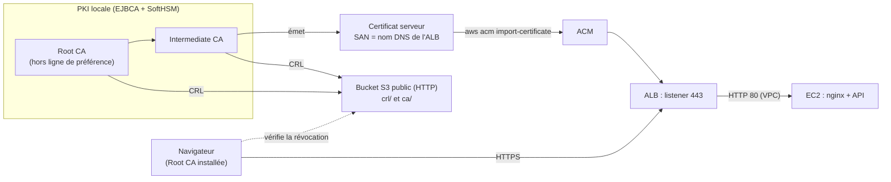

# HTTPS de Yoon avec la PKI EJBCA / SoftHSM

Ce guide sécurise l'application Yoon en HTTPS avec **nos propres certificats**, émis par la PKI
EJBCA (clés des CA dans SoftHSM), **sans acheter de nom de domaine** : le certificat est émis pour le
nom DNS que AWS attribue à l'ALB.

HTTPS est indispensable pour Yoon : les navigateurs refusent l'accès à la caméra (scanner de billets)
sur une page HTTP.

## Sommaire

1. [Vue d'ensemble](#vue-densemble)
2. [Contrainte : le nom de l'ALB](#contrainte--le-nom-de-lalb)
3. [4a. Bucket de publication des CRL](#4a-bucket-de-publication-des-crl)
4. [4b. Configuration EJBCA](#4b-configuration-ejbca)
5. [4c. Certificat serveur de l'ALB](#4c-certificat-serveur-de-lalb)
6. [4d. Import dans ACM](#4d-import-dans-acm)
7. [4e. Listener HTTPS sur l'ALB](#4e-listener-https-sur-lalb)
8. [4f. Confiance sur les appareils et tests](#4f-confiance-sur-les-appareils-et-tests)
9. [Exploitation : CRL, renouvellement, révocation](#exploitation--crl-renouvellement-révocation)
10. [Sécurité : ce qui ne doit jamais sortir](#sécurité--ce-qui-ne-doit-jamais-sortir)
11. [Dépannage](#dépannage)

---

## Vue d'ensemble



| # | Où | Quoi |
|---|---|---|
| 4a | Terraform `bootstrap/` | bucket S3 qui publie les CRL et certificats de CA en HTTP, à adresse fixe |
| 4b | EJBCA | adresses CDP / AIA dans les profils, génération et publication des CRL |
| 4c | Poste + EJBCA | clé et CSR (OpenSSL), émission du certificat serveur, vérification |
| 4d | AWS CLI | import dans ACM, qui renvoie un ARN |
| 4e | Terraform `modules/alb` | listener 443 et redirection 80 → 443 |
| 4f | Appareils | installation de la Root CA, tests (cadenas, caméra) |

L'ordre compte : les adresses des CRL sont **inscrites dans le certificat au moment de l'émission**.
Elles doivent donc exister (4a) et être configurées dans EJBCA (4b) avant d'émettre (4c).

## Contrainte : le nom de l'ALB

Sans domaine, le nom utilisé est celui de l'ALB, par exemple :

```
alb-moustapha-dev-755009444.eu-west-3.elb.amazonaws.com
```

Ce nom n'existe que tant que **cet ALB** existe. Un `destroy` puis un `apply` de l'environnement
crée un nouvel ALB avec un autre numéro : le certificat ne correspond plus (erreur
`NET::ERR_CERT_COMMON_NAME_INVALID`).

- Pendant la phase PKI : **ne pas détruire dev**.
- Si l'ALB est recréé : refaire 4c, 4d et mettre à jour `certificate_arn` (4e). Les étapes 4a, 4b
  et 4f ne sont pas à refaire.

Nom actuel :

```powershell
aws elbv2 describe-load-balancers --region eu-west-3 --names alb-moustapha-dev --query "LoadBalancers[0].DNSName" --output text
```

> **Pourquoi pas un certificat `*.eu-west-3.elb.amazonaws.com` ?**
> Il serait valable pour **tous** les ALB de la région, y compris ceux d'autres clients AWS. Sur un
> appareil qui fait confiance à notre Root CA, quiconque obtiendrait ce certificat et sa clé pourrait
> usurper n'importe lequel de ces sites. Un certificat ne doit couvrir que les noms que l'on contrôle.

Le jour où un domaine est acheté (par exemple `yoon.sn`), seul le SAN change : on émet un certificat
pour `yoon.sn` / `www.yoon.sn`, on ajoute un enregistrement DNS vers l'ALB, et toute la chaîne
ci-dessous reste valable.

---

## 4a. Bucket de publication des CRL

### Pourquoi

Un certificat indique où télécharger :

- la **CRL** (liste des certificats révoqués), extension *CRL Distribution Points* (CDP) ;
- le **certificat de l'autorité émettrice**, extension *Authority Information Access* (AIA).

Ces adresses doivent être :

- en **HTTP** et non HTTPS : vérifier la révocation d'un certificat HTTPS ne doit pas dépendre d'un
  autre certificat HTTPS (boucle) ; les CRL sont signées, leur intégrité ne dépend pas du transport ;
- **permanentes** : elles sont figées dans chaque certificat émis.

D'où un bucket dans le **bootstrap** (jamais détruit avec les environnements), indépendant de l'ALB.

### Fichiers

| Fichier | Rôle |
|---|---|
| `bootstrap/pki_publication.tf` | bucket, versionnage, chiffrement, lecture publique de `crl/*` et `ca/*` uniquement |
| `bootstrap/outputs_pki.tf` | sortie `pki_publication` : les quatre adresses à saisir dans EJBCA |

Le nom du bucket (`pki-moustapha-2026`) doit être unique au monde. Si AWS répond
`BucketAlreadyExists`, changer `local.pki_bucket` **avant** d'émettre le moindre certificat.

### Commandes

Le bootstrap a un état **local** : lancer depuis le poste qui le détient.

```powershell
cd C:\terraform_modules_moustapha\bootstrap
terraform plan     # attendu : 5 to add (bucket, versionnage, chiffrement, blocage public, politique), 0 to change, 0 to destroy
terraform apply
terraform output pki_publication
```

Résultat attendu :

```
{
  "bucket"                = "pki-moustapha-2026"
  "intermediate_cert_aia" = "http://pki-moustapha-2026.s3.eu-west-3.amazonaws.com/ca/intermediate-ca.crt"
  "intermediate_crl_cdp"  = "http://pki-moustapha-2026.s3.eu-west-3.amazonaws.com/crl/intermediate-ca.crl"
  "root_cert_aia"         = "http://pki-moustapha-2026.s3.eu-west-3.amazonaws.com/ca/root-ca.crt"
  "root_crl_cdp"          = "http://pki-moustapha-2026.s3.eu-west-3.amazonaws.com/crl/root-ca.crl"
}
```

Si `apply` échoue avec `AccessDenied ... public policies are blocked by the BlockPublicPolicy`,
le blocage d'accès public est activé **au niveau du compte** : S3 → *Block Public Access settings for
this account* → décocher uniquement les deux options « policies » (les ACL restent bloquées),
puis relancer `apply`.

---

## 4b. Configuration EJBCA

Dans l'interface d'administration EJBCA (`https://<ejbca>:8443/ejbca/adminweb/`).

### Publier les certificats des CA

**CA Functions → CA Certificates and CRLs** : télécharger les certificats de la Root et de
l'Intermediate au format **DER**, puis :

```powershell
aws s3 cp root-ca.der          s3://pki-moustapha-2026/ca/root-ca.crt         --content-type application/pkix-cert
aws s3 cp intermediate-ca.der  s3://pki-moustapha-2026/ca/intermediate-ca.crt --content-type application/pkix-cert
```

### Adresses CDP et AIA

Deux façons, au choix :

- **dans la CA** (CA Functions → Certification Authorities → *Edit CA*) : *Default CRL Distribution Point*
  et *Authority Information Access / CA issuer URI*, puis cocher *Use CA defined …* dans le profil ;
- **dans le profil de certificat** directement (méthode retenue ci-dessous, plus lisible).

| Profil | Émis par | CRL Distribution Point | AIA CA Issuer |
|---|---|---|---|
| Profil Sub CA (utilisé pour l'Intermediate) | Root CA | `root_crl_cdp` | `root_cert_aia` |
| `TLS-SERVER-YOON` (nouveau) | Intermediate CA | `intermediate_crl_cdp` | `intermediate_cert_aia` |

**L'Intermediate a-t-il déjà un CDP ?**

```bash
openssl x509 -in intermediate.pem -noout -text | grep -A3 "CRL Distribution\|Authority Information"
```

- Rien n'apparaît : la chaîne fonctionne quand même, mais la révocation de l'Intermediate ne peut pas
  être vérifiée. Pour une PKI complète : ajouter les adresses au profil Sub CA, puis
  **Edit CA → Renew CA** sur l'Intermediate (la Root le re-signe avec les nouvelles extensions).
  Republier ensuite `intermediate-ca.crt`.
- Une adresse apparaît déjà (autre serveur) : elle doit rester joignable, ou renouveler comme ci-dessus.

### Profil de certificat `TLS-SERVER-YOON`

**CA Functions → Certificate Profiles** → cloner `SERVER` sous le nom `TLS-SERVER-YOON` :

| Champ | Valeur |
|---|---|
| Available Key Algorithms | RSA (et ECDSA si souhaité) |
| Available Bit Lengths | 2048, 3072 (ACM accepte RSA 2048 à 4096 ; l'ALB sert RSA 2048 et ECDSA P-256/P-384) |
| Validity | **397d** (les navigateurs refusent plus de 398 jours) |
| Key Usage | Digital Signature, Key Encipherment ; critique |
| Extended Key Usage | **Server Authentication** uniquement |
| Subject Alternative Name | autorisé |
| CRL Distribution Points | activé, URI = `intermediate_crl_cdp` |
| Authority Information Access | activé, CA Issuer URI = `intermediate_cert_aia` (pas d'OCSP pour l'instant) |
| Available CAs | l'Intermediate CA uniquement |

### Profil d'entité finale `EE-TLS-YOON`

**RA Functions → End Entity Profiles** → nouveau profil :

| Champ | Valeur |
|---|---|
| Subject DN | `CN` obligatoire, `O = Yoon`, `C = SN` |
| Subject Alternative Name | **DNS Name** obligatoire (ajouter le champ) |
| Default / Available Certificate Profiles | `TLS-SERVER-YOON` |
| Default / Available CAs | Intermediate CA |
| Token | **User Generated** (la clé est créée par nous, voir 4c) |

### CRL

- **Edit CA** (Root et Intermediate) : *CRL Period* = 7 jours pour l'Intermediate, 30 à 90 jours
  pour la Root ; *CRL Issue Interval* = 1 jour pour l'Intermediate.
- **System Functions → Services** : service *CRL Updater* actif (chaque heure) pour que EJBCA
  régénère les CRL avant leur expiration.
- **CA Functions → CA Certificates and CRLs** → *Create CRL* pour chaque CA, puis télécharger au
  format **DER** et publier :

```powershell
aws s3 cp root-ca.crl          s3://pki-moustapha-2026/crl/root-ca.crl         --content-type application/pkix-crl
aws s3 cp intermediate-ca.crl  s3://pki-moustapha-2026/crl/intermediate-ca.crl --content-type application/pkix-crl
```

Test depuis n'importe où :

```bash
curl -sI http://pki-moustapha-2026.s3.eu-west-3.amazonaws.com/crl/intermediate-ca.crl   # HTTP/1.1 200 OK
curl -s  http://pki-moustapha-2026.s3.eu-west-3.amazonaws.com/crl/intermediate-ca.crl | openssl crl -inform DER -noout -issuer -lastupdate -nextupdate
```

---

## 4c. Certificat serveur de l'ALB

### Clé et CSR, sur le poste (OpenSSL)

La clé est générée **hors de SoftHSM** : ACM doit recevoir la clé privée en clair, ce qu'un HSM
refuse justement de fournir. SoftHSM protège les clés **des CA** ; la clé du serveur vit dans ACM.

Créer `alb.cnf` en remplaçant le nom par celui donné par `describe-load-balancers` :

```ini
[req]
prompt             = no
distinguished_name = dn
req_extensions     = ext

[dn]
CN = alb-moustapha-dev-755009444.eu-west-3.elb.amazonaws.com
O  = Yoon
C  = SN

[ext]
subjectAltName = DNS:alb-moustapha-dev-755009444.eu-west-3.elb.amazonaws.com
```

Sous Windows, OpenSSL est fourni avec Git (`C:\Program Files\Git\usr\bin\openssl.exe`) ; travailler
dans un dossier **hors de tout dépôt git**, par exemple `C:\pki-yoon\alb\`.

```bash
openssl req -new -newkey rsa:2048 -nodes -keyout alb.key -out alb.csr -config alb.cnf
openssl req -in alb.csr -noout -text | grep -A1 "Subject Alternative Name"
```

### Émission dans EJBCA

1. **RA Functions → Add End Entity** : profil `EE-TLS-YOON`, nom d'utilisateur `alb-yoon-dev`,
   CN et DNS Name = nom de l'ALB, mot de passe d'enrôlement (*Enrollment code*).
2. **RA Web** (`/ejbca/ra/`) → *Enroll* → *Use username* : `alb-yoon-dev` + code, coller `alb.csr`,
   télécharger le certificat au format **PEM** (`alb.crt`, certificat seul) et la chaîne.

### Vérifications avant import

```bash
# Le nom et l'usage
openssl x509 -in alb.crt -noout -subject -issuer -dates -ext subjectAltName,extendedKeyUsage,crlDistributionPoints

# La clé correspond au certificat (les deux empreintes doivent être identiques)
openssl x509 -in alb.crt -noout -pubkey | openssl sha256
openssl pkey -in alb.key -pubout       | openssl sha256

# La chaîne est valide
openssl verify -CAfile root-ca.pem -untrusted intermediate-ca.pem alb.crt

# La chaîne et les CRL (PEM) : aucun certificat révoqué
openssl crl -inform DER -in intermediate-ca.crl -out intermediate-ca.crl.pem
openssl crl -inform DER -in root-ca.crl         -out root-ca.crl.pem
openssl verify -crl_check_all -CAfile root-ca.pem -untrusted intermediate-ca.pem \
  -CRLfile intermediate-ca.crl.pem -CRLfile root-ca.crl.pem alb.crt
```

Toutes les commandes `verify` doivent répondre `alb.crt: OK`.

---

## 4d. Import dans ACM

La chaîne transmise à ACM contient l'Intermediate (la Root est déjà chez les clients) :

```powershell
$env:AWS_PAGER = ""
aws acm import-certificate `
  --region eu-west-3 `
  --certificate        fileb://alb.crt `
  --private-key        fileb://alb.key `
  --certificate-chain  fileb://intermediate-ca.pem `
  --tags Key=Project,Value=moustapha Key=Env,Value=dev Key=Emetteur,Value=EJBCA `
  --query CertificateArn --output text
```

La commande renvoie l'ARN : `arn:aws:acm:eu-west-3:231644789895:certificate/xxxxxxxx-...`.

```powershell
aws acm describe-certificate --region eu-west-3 --certificate-arn <ARN> `
  --query "Certificate.{Nom:DomainName,SAN:SubjectAlternativeNames,Type:Type,Expire:NotAfter,Statut:Status}"
```

Attendu : `Type = IMPORTED`, `Statut = ISSUED`.

Ensuite : **sauvegarder `alb.key` hors ligne** (clé USB chiffrée, coffre de mots de passe) ou la
supprimer. ACM la conserve chiffrée ; elle n'est plus nécessaire pour le fonctionnement.

ACM n'envoie **aucun** renouvellement automatique pour un certificat importé : surveiller la date
`Expire` (voir [Exploitation](#exploitation--crl-renouvellement-révocation)).

---

## 4e. Listener HTTPS sur l'ALB

### Fichiers modifiés

| Fichier | Changement |
|---|---|
| `modules/alb/variables.tf` | `certificate_arn` (défaut `null`) et `ssl_policy` |
| `modules/alb/main.tf` | listener 443 si certificat ; listener 80 → redirection 301 vers HTTPS |
| `modules/alb/outputs.tf` | `url_alb` en `https://` si certificat ; nouvelle sortie `https_enabled` |
| `modules/alb/README.md` | section HTTPS |
| `environments/{dev,staging,prod}/variables.tf` | `certificate_arn` (défaut `null`) |
| `environments/{dev,staging,prod}/main.tf` | `certificate_arn = var.certificate_arn` passé au module ALB |
| `environments/{dev,staging,prod}/outputs.tf` | `load_balancer_dns` (le nom à mettre dans le SAN) |

Les trois environnements restent identiques. Sans `certificate_arn`, staging et prod ne changent pas.

### Activation en dev

Dans `environments/dev/terraform.tfvars` (l'ARN n'est pas un secret) :

```hcl
certificate_arn = "arn:aws:acm:eu-west-3:231644789895:certificate/xxxxxxxx-..."
```

Pull request, puis lire le `plan` de dev **avant** de lancer l'apply :

| Attendu dans le plan | Signification |
|---|---|
| `module.alb.aws_lb_listener.https[0]` **will be created** | nouveau listener 443 |
| `module.alb.aws_lb_listener.http` **will be updated in-place** | forward → redirect |
| `0 to destroy` | rien n'est supprimé |

> Si le plan propose de **remplacer** `module.alb.aws_lb.main` ou les instances EC2 : ne pas appliquer.
> Le nom de l'ALB changerait et le certificat ne serait plus valable.

Puis **Actions → Terraform → Run workflow** : `apply`, environnement `dev`.

L'application n'a rien à modifier : nginx transmet déjà `X-Forwarded-Proto` à l'API, et le frontend
appelle `/api` en chemin relatif (pas de contenu mixte).

---

## 4f. Confiance sur les appareils et tests

Seule la **Root CA** s'installe sur les appareils (`root-ca.crt`, téléchargeable depuis
`root_cert_aia`). Ne jamais installer l'Intermediate ou le certificat serveur comme autorité.

| Appareil | Installation |
|---|---|
| Windows (Chrome, Edge) | double-clic sur `root-ca.crt` → *Installer le certificat* → Ordinateur local → *Autorités de certification racines de confiance* |
| Firefox | Paramètres → Vie privée et sécurité → Certificats → *Afficher les certificats* → Autorités → Importer, cocher « sites web » |
| Android (téléphone de l'agent) | Paramètres → Sécurité → Chiffrement et identifiants → *Installer un certificat* → **Certificat CA** |
| iPhone | ouvrir le fichier → installer le profil (Réglages → Profil téléchargé) puis Réglages → Général → Informations → *Réglages des certificats* → activer la confiance totale |
| Linux | `sudo cp root-ca.crt /usr/local/share/ca-certificates/ && sudo update-ca-certificates` |

Tests :

```bash
ALB=alb-moustapha-dev-755009444.eu-west-3.elb.amazonaws.com

# Redirection HTTP -> HTTPS
curl -sI http://$ALB/ | grep -i "^HTTP\|^location"        # 301, Location: https://...

# Chaîne présentée par l'ALB (certificat + Intermediate)
openssl s_client -connect $ALB:443 -servername $ALB -showcerts </dev/null 2>/dev/null | grep -E "s:|i:"

# Vérification complète avec notre Root
curl -s --cacert root-ca.pem https://$ALB/healthz           # ok
curl -s --cacert root-ca.pem https://$ALB/api/voyages | head -c 200
```

Dans le navigateur : cadenas sans avertissement, puis sur le téléphone de l'agent,
**Scanner → Activer la caméra** doit afficher la demande d'autorisation.

---

## Exploitation : CRL, renouvellement, révocation

| Tâche | Fréquence | Commande / action |
|---|---|---|
| Publier la CRL de l'Intermediate | avant chaque *Next Update* (≤ 7 j) | télécharger depuis EJBCA, `aws s3 cp ... crl/intermediate-ca.crl` |
| Publier la CRL de la Root | avant chaque *Next Update* | allumer la Root si hors ligne, *Create CRL*, `aws s3 cp` |
| Renouveler le certificat de l'ALB | 30 j avant `NotAfter` | nouvelle CSR, émission, réimport (ci-dessous) |
| ALB recréé | après un destroy/apply | 4c + 4d avec le nouveau nom, mettre à jour `certificate_arn` |

**Réimport (même nom, ARN conservé, aucune modification Terraform) :**

```powershell
aws acm import-certificate --region eu-west-3 --certificate-arn <ARN-existant> `
  --certificate fileb://alb.crt --private-key fileb://alb.key --certificate-chain fileb://intermediate-ca.pem
```

L'ALB utilise le nouveau certificat automatiquement.

**Nouveau nom (ALB recréé)** : importer **sans** `--certificate-arn` (nouvel ARN), mettre l'ARN dans
`terraform.tfvars`, appliquer, puis supprimer l'ancien certificat ACM et le révoquer dans EJBCA.

**Révocation** (clé compromise, ancien nom) : EJBCA → *Search End Entities* → *Revoke* (motif
*keyCompromise* ou *superseded*), *Create CRL*, republier `crl/intermediate-ca.crl`.

```bash
openssl crl -inform DER -in intermediate-ca.crl -noout -text | grep -A1 "Serial Number"
```

---

## Sécurité : ce qui ne doit jamais sortir

| Élément | Où il vit | Jamais |
|---|---|---|
| Clés des Root / Intermediate CA | SoftHSM (PIN utilisateur et SO) | exportées, copiées, dans git |
| `alb.key` | ACM (chiffrée), copie hors ligne éventuelle | dans git, dans le bucket, dans Terraform (`aws_acm_certificate` avec `private_key` la mettrait dans l'état) |
| PIN SoftHSM, mot de passe superadmin EJBCA | coffre de mots de passe | dans un fichier du projet |
| `root-ca.crt`, `intermediate-ca.crt`, CRL | bucket public | — ils sont publics par nature |

Le `.gitignore` du dépôt Terraform doit contenir au minimum :

```
*.key
*.pem
*.p12
*.pfx
*.csr
*.crl
```

---

## Dépannage

| Symptôme | Cause probable | Correction |
|---|---|---|
| `NET::ERR_CERT_AUTHORITY_INVALID` | Root CA non installée sur l'appareil | 4f |
| `NET::ERR_CERT_COMMON_NAME_INVALID` | SAN différent du nom tapé (ALB recréé, faute de frappe) | comparer `load_balancer_dns` et le SAN, réémettre |
| `ERR_CERT_VALIDITY_TOO_LONG` | validité > 398 jours | profil `TLS-SERVER-YOON` : 397d |
| `ValidationException` à l'import ACM | clé chiffrée, mauvais ordre, chaîne contenant le certificat serveur | `alb.key` sans mot de passe (`-nodes`), `--certificate` = certificat seul, chaîne = Intermediate |
| `openssl verify` : `unable to get certificate CRL` | CRL non téléchargée ou périmée | republier la CRL, vérifier `nextUpdate` |
| `CRL has expired` | CRL Updater arrêté ou CRL non republiée sur S3 | *Create CRL* puis `aws s3 cp` |
| `curl` 403 sur le bucket | fichier hors de `crl/` ou `ca/`, ou politique bloquée au niveau du compte | chemins exacts ; 4a, blocage public du compte |
| Caméra toujours refusée | page encore en HTTP, ou certificat non approuvé (Android ignore alors la permission) | ouvrir `https://`, installer la Root |
| Timeout sur `:443` | règle `alb_https` absente du groupe de sécurité | vérifier le module security |
