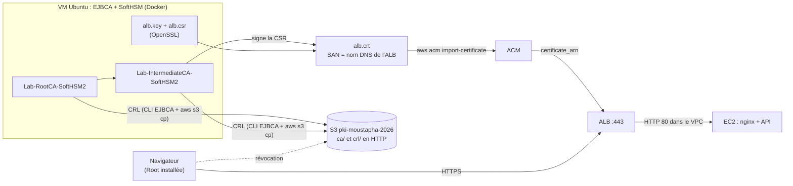

# HTTPS de Yoon avec la PKI EJBCA / SoftHSM : procédure

Ce guide sert de **procédure de référence** pour servir Yoon en HTTPS avec nos propres certificats, émis par
EJBCA (clés des autorités dans SoftHSM), **sans nom de domaine** : le certificat porte le nom DNS de l'ALB.
Il intègre les corrections découvertes lors de la mise en place (novembre 2026).

HTTPS est indispensable : les navigateurs refusent l'accès à la caméra (scanner de billets) sur une page HTTP.

Compte rendu de ce qui a été fait, avec les résultats : [`HTTPS-REALISATION-2026-11.md`](HTTPS-REALISATION-2026-11.md).

## Sommaire

1. [Vue d'ensemble](#vue-densemble)
2. [Décisions](#décisions)
3. [Où se fait quoi](#où-se-fait-quoi)
4. [4a. Bucket de publication](#4a-bucket-de-publication)
5. [4b. Réglages d'EJBCA](#4b-réglages-dejbca)
6. [4c. Clé, CSR et émission du certificat](#4c-clé-csr-et-émission-du-certificat)
7. [4d. Import dans ACM](#4d-import-dans-acm)
8. [4e. Listener 443](#4e-listener-443)
9. [4f. Confiance sur les appareils et tests](#4f-confiance-sur-les-appareils-et-tests)
10. [Exploitation](#exploitation)
11. [Sécurité](#sécurité)
12. [Dépannage](#dépannage)

---

## Vue d'ensemble



| # | Où | Quoi |
|---|---|---|
| 4a | Terraform `bootstrap/` (poste) | bucket S3 qui publie CRL et certificats de CA en HTTP |
| 4b | EJBCA (interface) | durées des CRL, adresses CDP / AIA, profils `TLS-SERVER-YOON` et `EE-TLS-YOON` |
| 4c | VM (terminal) | clé RSA 3072 + CSR, émission par la CLI EJBCA, vérifications |
| 4d | VM (AWS CLI) | import dans ACM |
| 4e | Terraform `environments/dev` | `certificate_arn` → listener 443, redirection 80 → 443 |
| 4f | Appareils | installation de la Root, tests (cadenas, caméra) |

L'ordre compte : les adresses des CRL sont **inscrites dans le certificat à l'émission**. Elles doivent exister (4a)
et être réglées dans EJBCA (4b) avant d'émettre (4c).

## Décisions

| Décision | Raison |
|---|---|
| Le certificat porte le **nom DNS de l'ALB** | pas de domaine ; ACM importe un certificat d'une CA privée pour n'importe quel nom |
| **Pas** de `*.eu-west-3.elb.amazonaws.com` | il couvrirait les ALB d'autres clients AWS : usurpation possible sur nos appareils |
| CRL et certificats de CA en **HTTP** sur un bucket du **bootstrap** | adresses figées dans les certificats, donc permanentes et indépendantes de l'ALB ; la CRL est signée |
| Clé de l'ALB créée par **OpenSSL**, importée par la **CLI** | ACM exige la clé en clair (un HSM ne la donnerait pas) ; par Terraform, elle serait dans l'état |
| **RSA 3072** | accepté par ACM et l'ALB ; plus robuste que 2048 |
| Émission par la **CLI EJBCA** | pas de faute de frappe sur le nom, CSR et clé restent dans la VM, réémission en une minute |
| TLS terminé sur l'ALB | HTTP vers les EC2 dans le VPC ; l'ALB ajoute `X-Forwarded-Proto: https` |

> Le nom de l'ALB **change à chaque recréation** de l'environnement. Pendant la phase HTTPS : ne pas détruire `dev`.
> Après une recréation : refaire 4c, 4d et 4e (voir [Exploitation](#si-dev-est-recréé)).

## Où se fait quoi

| Poste | Rôle |
|---|---|
| Windows (`C:\terraform_modules_moustapha`) | Git, bootstrap Terraform, installation de la Root |
| VM Ubuntu (VirtualBox) | EJBCA (`https://15d79debc069:18443/ejbca/adminweb/`), conteneurs `ejbca-hsm-lab-ejbca-1` et `ejbca-hsm-lab-mariadb-1`, dossiers `~/pki-yoon/ca` et `~/pki-yoon/alb`, AWS CLI (profil `moustapha-login`) |
| GitHub Actions | `plan` sur PR, `apply` de `dev` |

Variables utilisées dans la VM :

```bash
export AWS_PROFILE=moustapha-login AWS_REGION=eu-west-3 AWS_PAGER=""
EJBCA="docker exec ejbca-hsm-lab-ejbca-1 /opt/keyfactor/bin/ejbca.sh"
ALB=$(aws elbv2 describe-load-balancers --names alb-moustapha-dev --query "LoadBalancers[0].DNSName" --output text)
echo "$ALB"
```

Connexion AWS dans la VM : `aws login --profile moustapha-login --region eu-west-3 --remote`, ouvrir l'URL dans
Firefox **de la VM**, se connecter, cliquer **Copy verification code** et coller ce code (pas le mot de passe).

---

## 4a. Bucket de publication

Fichiers : `bootstrap/pki_publication.tf` (bucket `pki-moustapha-2026`, versionné, AES256, ACL bloquées, lecture
publique de `crl/*` et `ca/*` uniquement) et `bootstrap/outputs_pki.tf`.

```powershell
cd C:\terraform_modules_moustapha\bootstrap
terraform plan      # 5 to add, 0 to change, 0 to destroy
terraform apply
terraform output pki_publication
```

| Sortie | Adresse | Inscrite dans |
|---|---|---|
| `root_crl_cdp` | `http://pki-moustapha-2026.s3.eu-west-3.amazonaws.com/crl/root-ca.crl` | certificats émis par la Root |
| `root_cert_aia` | `http://pki-moustapha-2026.s3.eu-west-3.amazonaws.com/ca/root-ca.crt` | idem |
| `intermediate_crl_cdp` | `http://pki-moustapha-2026.s3.eu-west-3.amazonaws.com/crl/intermediate-ca.crl` | certificats émis par l'Intermediate |
| `intermediate_cert_aia` | `http://pki-moustapha-2026.s3.eu-west-3.amazonaws.com/ca/intermediate-ca.crt` | idem |

Vérification : `curl.exe -sI http://pki-moustapha-2026.s3.eu-west-3.amazonaws.com/` → **403** (listage interdit).

---

## 4b. Réglages d'EJBCA

### Les CA (*CA Functions → Certification Authorities → Edit CA*)

| Champ | Root `Lab-RootCA-SoftHSM2` | Intermediate `Lab-IntermediateCA-SoftHSM2` |
|---|---|---|
| CRL Expire Period | `30d` | `7d` |
| CRL Issue Interval | `0m` | `1d` |
| CRL Overlap Time | `1d` | `1d` |
| Generate CRL Upon Revocation | ☑ | ☑ |
| Default CRL Distribution Point | `…/crl/root-ca.crl` | `…/crl/intermediate-ca.crl` |
| Default CRL Issuer | **vide** | **vide** |
| CA issuer Default URI | `…/ca/root-ca.crt` | `…/ca/intermediate-ca.crt` |

Cliquer **Save** tout en bas. Ne pas toucher à *Renew CA*, *Revoke*, *Externally signed CA*,
*Microsoft CA Compatibility Mode* (irréversible).

> **Default CRL Issuer** désigne une *autre* autorité qui signerait les CRL (CRL indirectes) : il doit rester vide.
> L'adresse du certificat de la CA va dans **CA issuer Default URI**.

Service de mise à jour des CRL : *System Functions → Services* → `CRL Updater`, worker *CRL Updater*,
les deux CA, intervalle 1 heure, ☑ Active. Il régénère les CRL dans EJBCA ; la copie vers S3 reste manuelle.

### Profil de certificat `TLS-SERVER-YOON` (*CA Functions → Certificate Profiles*, clone de `SERVER`)

| Champ | Valeur |
|---|---|
| Type | End Entity |
| Available Key Algorithms | RSA |
| Available Bit Lengths | 2048, 3072, 4096 (Ctrl+clic) |
| Signature Algorithm | Inherit from issuing CA |
| Validity | `1y 1mo 2d` (397 jours) |
| Permissions *Allow … Override* | toutes décochées |
| **Use Certificate Storage** | ☑ (sinon le certificat ne peut être ni retrouvé ni révoqué) |
| **Store Certificate Data** | ☑ |
| Basic Constraints | ☑ Use, ☑ Critical |
| Key Usage | ☑ Use, ☑ Critical : Digital Signature, Key encipherment |
| Extended Key Usage | ☑ Use : Server Authentication |
| Subject Alternative Name | ☑ Use |
| CRL Distribution Points | ☑ Use + **☑ Use CA defined CRL Distribution Point** |
| Authority Information Access | ☑ Use + ☑ Use CA defined CA issuer |
| Available CAs | `Lab-IntermediateCA-SoftHSM2` uniquement |

### Profil d'entité `EE-TLS-YOON` (*RA Functions → End Entity Profiles*)

| Champ | Valeur |
|---|---|
| Username, Password | vides ; Password ☑ Required |
| End Entity E-mail | ☐ Use |
| CN | vide, ☑ Required, ☑ Modifiable |
| O | `YOON`, ☑ Required, ☐ Modifiable |
| C | `SN`, ☑ Required, ☐ Modifiable |
| Subject Alternative Name : DNS Name | vide, ☑ Required, **☑ Modifiable** |
| Default / Available Certificate Profiles | `TLS-SERVER-YOON` seul |
| Default / Available CAs | `Lab-IntermediateCA-SoftHSM2` seule |
| Default / Available Tokens | **User Generated** seul |

> Listes à sélection multiple : un clic simple ne garde que l'élément cliqué ; Ctrl+clic ajoute ou retire.

### Vérifier ce qui est réellement enregistré

L'écran peut afficher des cases cochées qui n'ont pas été enregistrées. Contrôle fiable :

```bash
docker exec -u root ejbca-hsm-lab-ejbca-1 rm -rf /tmp/profils
docker exec ejbca-hsm-lab-ejbca-1 mkdir -p /tmp/profils
$EJBCA ca exportprofiles -d /tmp/profils >/dev/null
P=/tmp/profils/certprofile_TLS-SERVER-YOON-334309444.xml
docker exec ejbca-hsm-lab-ejbca-1 grep -i -A1 -E "<string>(usedefaultcrldistributionpoint|usecertificatestorage|storecertificatedata|useauthorityinformationaccess)</string>" $P
docker exec ejbca-hsm-lab-ejbca-1 grep -i -A12 "<string>availablebitlengths</string>" $P | grep "<int>"
```

Attendu : quatre `<boolean>true</boolean>`, puis `2048`, `3072`, `4096`.

### Certificats de CA et CRL : récupération et publication

```bash
mkdir -p ~/pki-yoon/ca && cd ~/pki-yoon/ca
# certificats : CA Structure & CRLs → Download PEM file (Root, puis ligne « Subordinate CA »)
mv ~/Téléchargements/LabRootCASoftHSM2.cacert.pem          root-ca.pem
mv ~/Téléchargements/LabIntermediateCASoftHSM2.cacert.pem  intermediate-ca.pem
openssl x509 -in root-ca.pem         -outform DER -out root-ca.der
openssl x509 -in intermediate-ca.pem -outform DER -out intermediate-ca.der
openssl verify -CAfile root-ca.pem intermediate-ca.pem          # intermediate-ca.pem: OK

# CRL par la CLI (pour la Root : remplacer le nom de la CA et le fichier)
$EJBCA ca createcrl --caname "Lab-IntermediateCA-SoftHSM2"
$EJBCA ca getcrl --caname "Lab-IntermediateCA-SoftHSM2" -f /tmp/intermediate-ca.crl
docker cp ejbca-hsm-lab-ejbca-1:/tmp/intermediate-ca.crl intermediate-ca.crl
openssl crl -inform DER -in intermediate-ca.crl -noout -issuer -crlnumber -nextupdate

aws s3 cp root-ca.der         s3://pki-moustapha-2026/ca/root-ca.crt          --content-type application/pkix-cert
aws s3 cp intermediate-ca.der s3://pki-moustapha-2026/ca/intermediate-ca.crt  --content-type application/pkix-cert
aws s3 cp root-ca.crl         s3://pki-moustapha-2026/crl/root-ca.crl         --content-type application/pkix-crl
aws s3 cp intermediate-ca.crl s3://pki-moustapha-2026/crl/intermediate-ca.crl --content-type application/pkix-crl
curl -s http://pki-moustapha-2026.s3.eu-west-3.amazonaws.com/crl/intermediate-ca.crl | openssl crl -inform DER -noout -crlnumber -nextupdate
```

Les noms **dans le bucket** sont fixes : ils sont inscrits dans les certificats.

---

## 4c. Clé, CSR et émission du certificat

Dans la VM, dossier `~/pki-yoon/alb` (droits 700). `$ALB` doit être défini et non vide.

```bash
mkdir -p ~/pki-yoon/alb && chmod 700 ~/pki-yoon/alb && cd ~/pki-yoon/alb
cat > alb.cnf <<EOF
[req]
prompt             = no
distinguished_name = dn
req_extensions     = ext

[dn]
CN = $ALB
O  = YOON
C  = SN

[ext]
subjectAltName = DNS:$ALB
EOF
openssl req -new -newkey rsa:3072 -nodes -keyout alb.key -out alb.csr -config alb.cnf
chmod 600 alb.key
openssl req -in alb.csr -noout -verify -subject
openssl req -in alb.csr -noout -text | grep -E "Public-Key|DNS:"
```

Émission (création de l'entité la première fois, puis signature de la CSR) :

```bash
CODE=$(openssl rand -hex 16)          # code d'enrôlement aléatoire, jamais affiché
$EJBCA ra addendentity --username alb-yoon-dev --password "$CODE" \
  --dn "CN=$ALB,O=YOON,C=SN" --altname "dNSName=$ALB" \
  --caname "Lab-IntermediateCA-SoftHSM2" --type 1 --token USERGENERATED \
  --certprofile TLS-SERVER-YOON --eeprofile EE-TLS-YOON
docker cp alb.csr ejbca-hsm-lab-ejbca-1:/tmp/alb.csr
$EJBCA createcert --username alb-yoon-dev --password "$CODE" -c /tmp/alb.csr -f /tmp/alb.crt
docker cp ejbca-hsm-lab-ejbca-1:/tmp/alb.crt alb.crt
docker exec -u root ejbca-hsm-lab-ejbca-1 rm -f /tmp/alb.csr /tmp/alb.crt
unset CODE
```

Réémettre avec la même entité (même nom d'ALB) :

```bash
CODE=$(openssl rand -hex 16)
$EJBCA ra setclearpwd --username alb-yoon-dev --password "$CODE"
$EJBCA ra setendentitystatus --username alb-yoon-dev -S 10      # 10 = NEW
# puis docker cp alb.csr …, createcert …, docker cp … comme ci-dessus
```

Si le nom de l'ALB a changé, modifier le DN et le SAN de l'entité (*RA Functions → Search End Entities → Edit*),
ou créer une nouvelle entité (ex. `alb-yoon-dev-2`).

Vérifications :

```bash
openssl x509 -in alb.crt -noout -subject -issuer -dates -serial
openssl x509 -in alb.crt -noout -ext subjectAltName,keyUsage,extendedKeyUsage,crlDistributionPoints,authorityInfoAccess
openssl x509 -in alb.crt -noout -pubkey | openssl sha256
openssl pkey -in alb.key -pubout        | openssl sha256          # identique à la ligne précédente
openssl verify -crl_check -CRLfile <(openssl crl -inform DER -in ../ca/intermediate-ca.crl) \
  -CAfile ../ca/root-ca.pem -untrusted ../ca/intermediate-ca.pem alb.crt     # alb.crt: OK
```

| Élément | Attendu |
|---|---|
| subject / SAN | nom de l'ALB, `O = YOON`, `C = SN` |
| issuer | `Lab-IntermediateCA-SoftHSM2` |
| Public-Key | 3072 bit |
| Key Usage / EKU | Digital Signature, Key Encipherment (critique) / TLS Web Server Authentication |
| CRL Distribution Points | `URI:…/crl/intermediate-ca.crl`, sans ligne `CRL Issuer` |
| Authority Information Access | `CA Issuers - URI:…/ca/intermediate-ca.crt` |
| RA Web → Search → Certificates | le certificat apparaît, statut **Active** |

---

## 4d. Import dans ACM

Premier import (nouvel ARN) :

```bash
cd ~/pki-yoon/alb
ARN=$(aws acm import-certificate \
  --certificate       fileb://alb.crt \
  --private-key       fileb://alb.key \
  --certificate-chain fileb://../ca/intermediate-ca.pem \
  --tags Key=Project,Value=moustapha Key=Env,Value=dev Key=Emetteur,Value=EJBCA \
  --query CertificateArn --output text)
echo "$ARN" > acm-arn.txt
aws acm describe-certificate --certificate-arn "$ARN" \
  --query "Certificate.{Nom:DomainName,SAN:SubjectAlternativeNames,Type:Type,Statut:Status,Cle:KeyAlgorithm,Expire:NotAfter}"
```

Attendu : `IMPORTED`, `ISSUED`, `RSA-3072`.

Réimport (renouvellement ou correction, **même nom d'ALB**) : l'ALB prend le nouveau certificat sans changement Terraform.

```bash
aws acm import-certificate --certificate-arn "$(cat acm-arn.txt)" \
  --certificate fileb://alb.crt --private-key fileb://alb.key \
  --certificate-chain fileb://../ca/intermediate-ca.pem
```

---

## 4e. Listener 443

Le module `modules/alb` crée le listener 443 et transforme le port 80 en redirection quand `certificate_arn` est
renseigné (`null` par défaut : HTTP seul). La valeur se met dans `environments/dev/terraform.tfvars`
(fichier suivi par Git, lu par la pipeline) ; l'ARN n'est pas un secret.

```powershell
git fetch origin; git switch -c https-dev origin/main
Add-Content -Path environments\dev\terraform.tfvars -Value "`ncertificate_arn = `"arn:aws:acm:eu-west-3:231644789895:certificate/…`""
terraform fmt environments\dev\terraform.tfvars
git diff
git add environments/dev/terraform.tfvars
git commit -m "feat(dev): HTTPS sur l'ALB"
git push -u origin https-dev
```

Plan attendu pour `dev` : `aws_lb_listener.https[0]` créé, `aws_lb_listener.http` modifié en place,
`1 to add, 1 to change, 0 to destroy`. **Ne pas fusionner** si l'ALB, les EC2 ou RDS seraient remplacés.
Puis *Run workflow* → `apply` / `dev`.

Tests (VM) :

```bash
curl -sI "http://$ALB/" | grep -iE "^HTTP|^location"                          # 301 vers https://
curl -s --cacert ~/pki-yoon/ca/root-ca.pem "https://$ALB/healthz"; echo     # ok
echo | openssl s_client -connect "$ALB:443" -servername "$ALB" 2>/dev/null | openssl x509 -noout -serial -ext crlDistributionPoints
```

---

## 4f. Confiance sur les appareils et tests

Installer **uniquement la Root**, depuis `http://pki-moustapha-2026.s3.eu-west-3.amazonaws.com/ca/root-ca.crt`,
et **comparer son empreinte** avant d'accepter :

```
SHA-1 : BD:C1:3C:57:0B:FD:A2:E4:37:6D:24:8E:35:20:23:E4:29:E4:6A:5A
```

| Appareil | Installation |
|---|---|
| Windows (sans droits admin) | `certutil -user -addstore Root C:\pki-yoon\ca\root-ca.crt`, vérifier l'empreinte dans la fenêtre, **Oui** ; contrôle : `certutil -user -store Root "Lab-RootCA-SoftHSM2"` |
| Windows (tout le PC) | même commande sans `-user`, PowerShell **administrateur** |
| Firefox (Windows) | reprend automatiquement le magasin Windows ; sinon *Paramètres → Vie privée et sécurité → Certificats → Autorités → Importer* |
| Android (Samsung) | toucher le fichier ne suffit pas (« Impossible d'installer les certificats AC ») : *Paramètres → Sécurité et confidentialité → Autres paramètres de sécurité → Installer depuis le stockage de l'appareil → Certificat AC → Installer quand même* |
| iPhone | *Réglages → Profil téléchargé → Installer*, puis *Général → Informations → Réglages des certificats* : confiance totale |
| Linux | `sudo cp root-ca.crt /usr/local/share/ca-certificates/ && sudo update-ca-certificates` |

Vérifier dans Firefox : cadenas → *Connexion sécurisée → Plus d'informations* : « Vérifiée par : PKI LAB », TLS 1.3 ;
*Afficher le certificat* : onglets serveur, Intermediate, Root.

Test final (téléphone de l'agent) : se connecter en agent, *Scanner → Activer la caméra → Autoriser*, scanner un billet :
« Billet valide », puis « Billet déjà utilisé » au second scan.

---

## Exploitation

### Publier les CRL

| CRL | Validité | Commande |
|---|---|---|
| Intermediate | 7 jours | voir ci-dessous, chaque semaine avant *nextUpdate* |
| Root | 30 jours | idem avec `Lab-RootCA-SoftHSM2` et `crl/root-ca.crl` |

```bash
cd ~/pki-yoon/ca
$EJBCA ca createcrl --caname "Lab-IntermediateCA-SoftHSM2"
$EJBCA ca getcrl --caname "Lab-IntermediateCA-SoftHSM2" -f /tmp/intermediate-ca.crl
docker cp ejbca-hsm-lab-ejbca-1:/tmp/intermediate-ca.crl intermediate-ca.crl
openssl crl -inform DER -in intermediate-ca.crl -noout -crlnumber -nextupdate
aws s3 cp intermediate-ca.crl s3://pki-moustapha-2026/crl/intermediate-ca.crl --content-type application/pkix-crl
```

### Si dev est recréé

1. Nouveau nom : `ALB=$(aws elbv2 describe-load-balancers …)`.
2. 4c : nouvelle clé et CSR, entité mise à jour (DN et SAN), émission.
3. 4d : import **sans** `--certificate-arn` → nouvel ARN.
4. 4e : nouvel ARN dans `terraform.tfvars`, PR, apply.
5. Révoquer l'ancien certificat et supprimer l'ancien certificat ACM : `aws acm delete-certificate --certificate-arn <ancien>`.

### Renouveler (30 jours avant expiration)

Réémission avec la même entité (`setclearpwd`, `setendentitystatus -S 10`, `createcert`), puis réimport sur le même ARN.

### Révoquer un certificat

```bash
SERIAL=$(openssl x509 -in cert.crt -noout -serial | cut -d= -f2 | sed 's/^0*//')   # EJBCA : sans zéro initial
$EJBCA ra revokecert --dn "CN=Lab-IntermediateCA-SoftHSM2,O=PKI LAB,C=FR" -s "$SERIAL" -r 4   # 4 = superseded
```

Puis publier la nouvelle CRL. Par l'interface : *RA Web → Search → Certificates* → le certificat → *Revoke*.

> **Ne pas utiliser** *Revoke Selected* de *Search End Entities* pour un seul certificat : il révoque **tous** les
> certificats de l'entité, y compris celui en service.

## Sécurité

| Élément | Où il vit | Jamais |
|---|---|---|
| Clés de la Root et de l'Intermediate | SoftHSM, dans la VM | exportées, copiées, dans Git |
| `alb.key` | ACM (chiffrée) et `~/pki-yoon/alb` (600) | dans Git, sur S3, dans Terraform (`aws_acm_certificate` avec `private_key` la mettrait dans l'état) |
| Code d'enrôlement | variable `CODE` du terminal, effacée par `unset` | affiché, écrit dans un fichier |
| `SuperAdmin.p12`, PIN SoftHSM | `~/pki-lab-backups/admin` (700/600), coffre de mots de passe | dans un fichier du projet |
| Certificats de CA, CRL, CSR | publics | — |

Le dossier partagé VirtualBox ne sert qu'aux fichiers publics. Prendre un instantané de la VM avant toute installation
qui touche au noyau ; ne jamais restaurer un instantané sans vérifier sa date (un instantané antérieur au 16/10/2026
effacerait les CA).

## Dépannage

| Symptôme | Cause | Correction |
|---|---|---|
| `NET::ERR_CERT_AUTHORITY_INVALID` | Root non installée | 4f |
| `NET::ERR_CERT_COMMON_NAME_INVALID` | ALB recréé, nom différent du SAN | [Si dev est recréé](#si-dev-est-recréé) |
| `ERR_CERT_VALIDITY_TOO_LONG` | validité > 398 jours | profil : `1y 1mo 2d` |
| `LoadBalancerNotFound` | `dev` détruit | recréer, puis réémettre |
| `Illegal key length, not authorized by certificate profile` | taille absente du profil (enregistrement raté) | corriger le profil, vérifier par `ca exportprofiles` |
| Certificat sans CDP | *Use CA defined CRL Distribution Point* non enregistré | idem, puis réémettre et réimporter |
| `No certificate found` à la révocation | *Use Certificate Storage* désactivé, ou zéro initial du numéro de série | activer le stockage et réémettre ; `sed 's/^0*//'` |
| `Password decryption failed` (CLI EJBCA) | message de configuration de la CLI | sans effet |
| `rm: Operation not permitted` dans le conteneur | fichier copié en root par `docker cp` | `docker exec -u root …` |
| `ValidationException` à l'import ACM | clé chiffrée, ou chaîne incluant le certificat serveur | `-nodes` ; `--certificate` = certificat seul ; chaîne = Intermediate |
| `CRL has expired` | CRL non republiée | publier la CRL |
| `certutil … nécessite une élévation` | magasin de l'ordinateur | `certutil -user …` ou PowerShell administrateur |
| Android : « Impossible d'installer les certificats AC » | Android 11+ | installation par les Paramètres |
| `aws login` : « Failed to decode the verification code » | mot de passe collé au lieu du code | coller le code de vérification |
| Avertissement `Invalid Attribute Combination` à l'apply | passage du port 80 de *forward* à *redirect* (provider) | sans effet ; vérifier au plan suivant |
